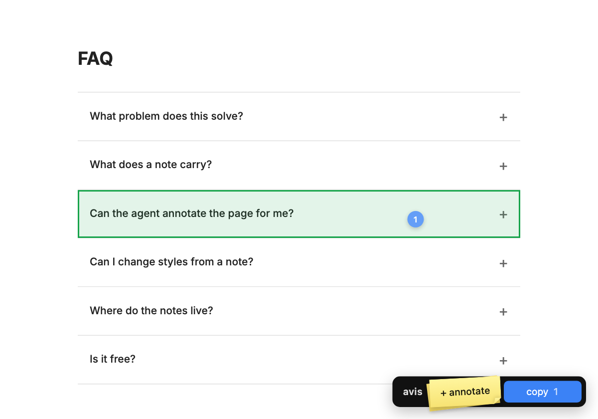

Telling Claude "make this button bigger" doesn't say *which* button. You end up describing rectangles like a court witness. [Avis](https://sryo.github.io/avis/) lets you point at it instead.

## What it does

- Run `/avis`: a toolbar lands on your open page. Click `+ annotate`, point at elements, leave a note on each, type "done".
- Each note tells the agent exactly which element you mean, what you clicked before it and what errors showed up.
- Sliders tweak the CSS rule behind the element, live; the agent gets the before and after.
- Flip it: the agent pins its own notes, and you reply on the page.

Point at it, write what should change, type done, and the agent edits and closes the note.

## Screens

<iframe style="border: 1px solid rgba(0, 0, 0, 0.1);" width="100%" height="450" src="https://embed.figma.com/design/oaDVQzr8MaIVNtAUjqs88B/avis?node-id=0-1&embed-host=share" allowfullscreen></iframe>

## Decisions

### Point, don't describe

I chose pointing over describing. A sentence can't say which button. A click on it can, and the note stays pinned to that element.

### Tweak it live before the agent edits

A note can carry a change. The sliders move the real style rule on the page, so you see the result first. The agent gets the value before and after, and edits that rule in the source.

### The agent can write on the page too

It works both ways. Ask the agent to review a page and it pins its own notes there, in purple. You reply on the page, next to the thing in question, so you see each note in context.
