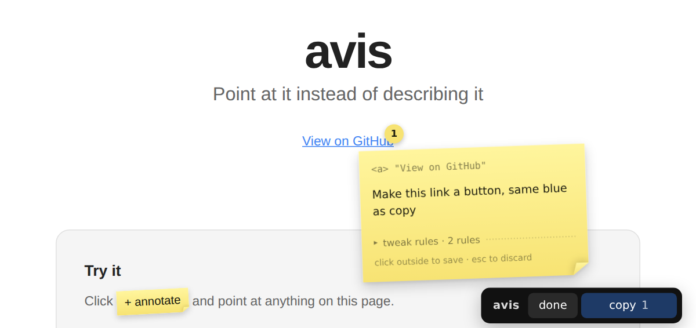
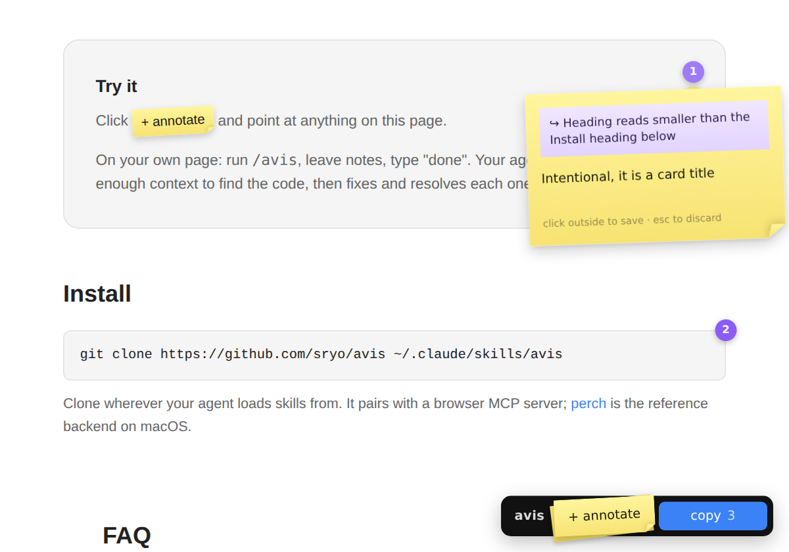

Telling Claude "make this button bigger" doesn't say *which* button. You end up describing rectangles like a court witness. [Avis](https://sryo.github.io/avis/) lets you point at it instead.

## What it does

- Run `/avis`: a toolbar lands on your open page. Click `+ annotate`, point at elements, leave a note on each, type "done".
- Each note carries the element, its text, a unique selector, recent clicks and console output; on React dev builds, the source file and line.
- Sliders tweak the CSS rule behind the element, live; the agent gets the before and after.
- Flip it: the agent pins its own notes, and you reply on the page.

## Screens

<iframe style="border: 1px solid rgba(0, 0, 0, 0.1);" width="100%" height="450" src="https://embed.figma.com/design/oaDVQzr8MaIVNtAUjqs88B/avis?node-id=0-1&embed-host=share" allowfullscreen></iframe>

## How it works

DIAGRAM: diagram.svg "The skill mounts one script on the page; the agent reads your notes back through it"

The `/avis` skill has [perch](https://github.com/sryo/perch), a small AppleScript/JXA driver for Chrome and Safari, run `toolbar.js` in your tab. Notes persist in `localStorage` and nothing is sent anywhere. On "done", Claude Code calls `__avis.summary()`, finds the source, edits it, and resolves each note so no stale marker stays behind.

## Details

- A Claude Code skill: one `SKILL.md` and one vanilla-JS file, no build, no runtime dependencies
- The toolbar mounts in Shadow DOM, so page styles never leak into it
- Pairs with a browser MCP server; perch (macOS) is the reference backend
- Tested with node:test and happy-dom
- Open source under its own share-alike, no-liability license
