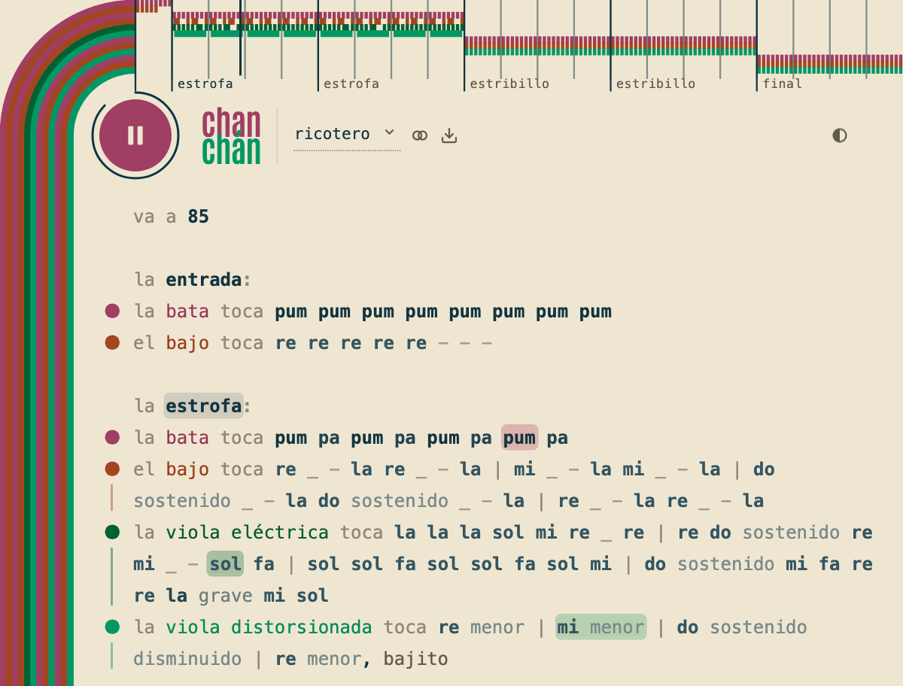
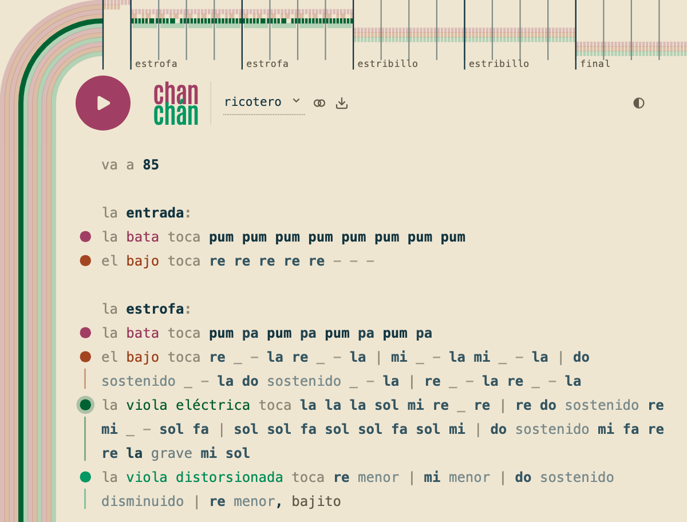

Writing down a beat means learning notation, but most people can already sing it: pum pa pum pa. [Chanchán](https://sryo.github.io/chanchan/) plays what you type, and the sheet of text is the whole song, so sending the link sends the song.

## What it does

- Each line says who plays what: `la bata toca pum pa pum pa` is drums, `el bajo toca do - sol -` is notes, `el piano toca do mayor` is chords.
- Sections, form and tempo are lines too: `la estrofa:`, `el tema va estrofa estribillo`, `va a 85`.
- No hidden state: muting means writing `callado`, and the ▾ menu edits the text.
- Copy link packs the song, and songs it names with `@`, into the address.

DIAGRAM: diagram.svg "Type a beat in words, hear it, swap a word, send the link, and a friend hears the same song"

## Screens

<iframe style="border: 1px solid rgba(0, 0, 0, 0.1);" width="100%" height="450" src="https://embed.figma.com/design/9FGnsvKtb8PK2WMNlffhjy/Chanch%C3%A1n?node-id=0-1&embed-host=share" allowfullscreen></iframe>

## Decisions

### Words you'd sing, not notation

I chose plain Spanish lines over notation. Most people can't write a beat down, but they can sing it. So drums are spelled the way you'd sing them, `pum pa`, and a chord is `do mayor`.

### Nothing lives outside the text

Everything that changes the sound is written on the sheet. There's no mute switch: you write `callado`. The ▾ menus and the dots in the margin edit the words instead of keeping a setting on the side. That way the song someone else opens plays exactly the same.

### The link is the song

Copy link puts the whole sheet in the address, short enough to fit in a message, with any song it points to with `@`. Pasted in a chat, it shows a card with the first sheet's three lines.
