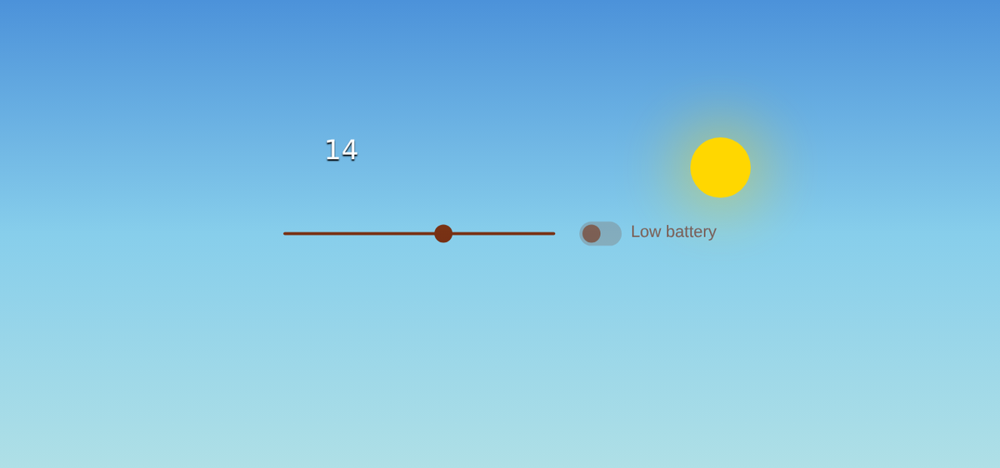

I kept losing track of time while working, so I built [ChronoMouse](https://sryo.github.io/ChronoMouse/), a thing that shows it next to the cursor, where I'm already looking.

## What it does

- Move the mouse and the hour appears beside the pointer, orbiting it like a minute hand
- It fades out after 2 seconds idle, and right away when you type or drag
- Hold Option to see the minutes instead of the hour
- Below 25% battery a bar appears under the hour; below 10% the hour turns red

DIAGRAM: diagram.svg "Move the mouse and the hour appears beside it; where it sits tells you the minutes"

## Screens

## Decisions

### The clock goes where you're looking

A Mac already has a clock, up in the corner of the menu bar. I kept losing track of time anyway, so I put a second one next to the pointer, where my eyes already are while I work.

### One number, and its place tells the rest

It shows only the hour. The minutes are in where the hour sits: to the right of the pointer at quarter past, below it at half past, like the tip of a minute hand. Two days after the first release, holding Option started showing the minutes as a number.
