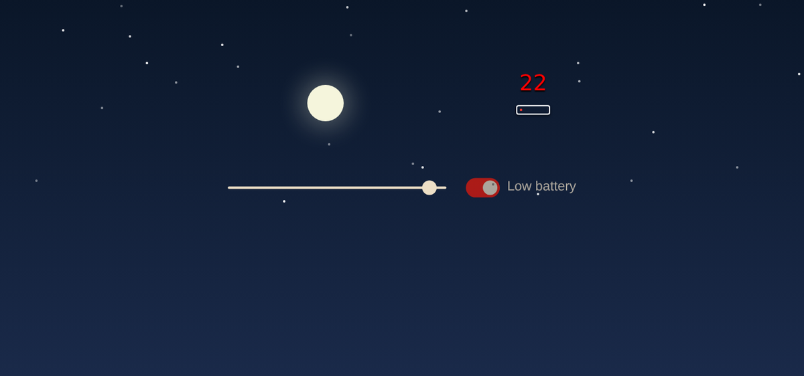

I kept losing track of time while working, so I built [ChronoMouse](https://sryo.github.io/ChronoMouse/), a thing that shows it next to the cursor, where I'm already looking.

## What it does

- Move the mouse and the hour appears beside the pointer, orbiting it like a minute hand
- It fades out after 2 seconds idle, and right away when you type or drag
- Hold Option to see the minutes instead of the hour
- Below 25% battery a bar appears under the hour; below 10% the hour turns red

## Screens

## How it works

DIAGRAM: diagram.svg "Your mouse and keys move one small window around the pointer; the battery adds a warning"

Global event monitors watch the mouse, keys and Option without needing focus. On each move it reads the clock, turns the minute into an angle and places a borderless, click-through window 30 points from the pointer on that angle. IOKit reports the battery every 60 seconds.

## Details

- Pure AppKit in Swift for macOS 13 and later, no dependencies
- No Dock icon; the window floats above full-screen apps on every Space
- Needs one Accessibility permission; signed with Developer ID and notarized, not on the App Store
- Settings for font size, orbit radius, fade delay, battery threshold and launch at login
- No telemetry; open source under its own share-alike, no-liability license
