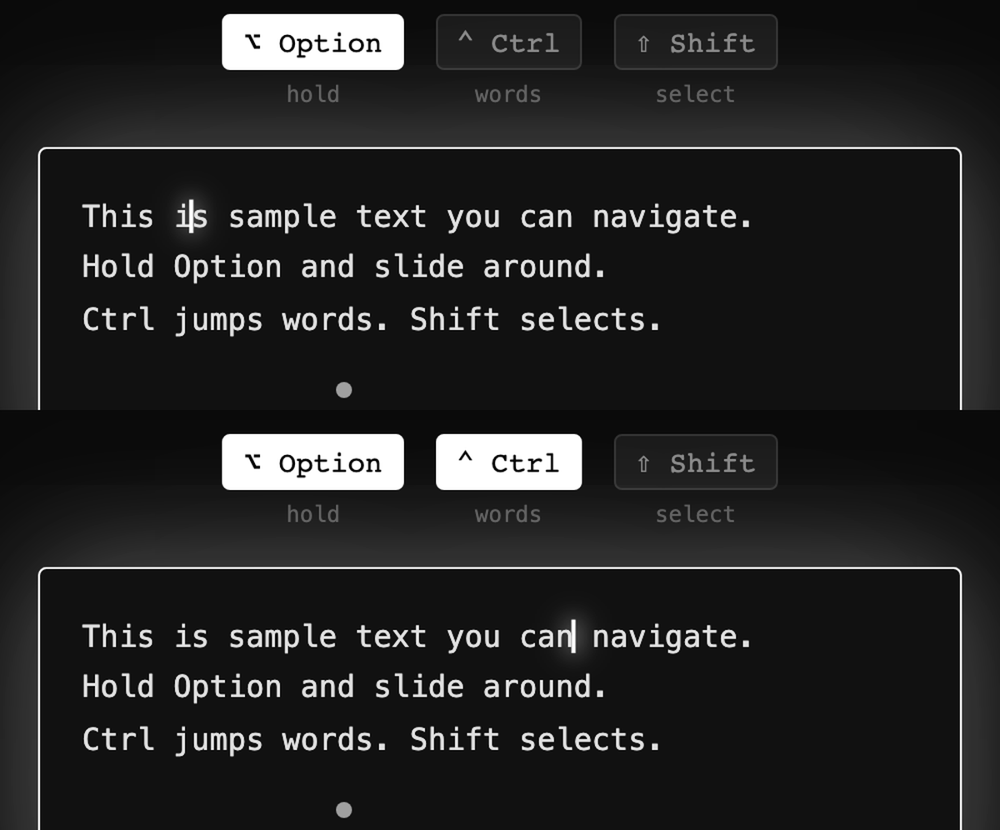

fzf, autocomplete, file pickers, vim. Every fast-CLI workflow eventually becomes "press the arrow key 47 times," while the trackpad sits there with way more bandwidth than four keys. [Dirpad](https://github.com/sryo/dirpad) lets it talk to apps in a language they already speak: arrow keys.

## What it does

- Hold the trigger key (Option by default) and slide the trackpad: the movement becomes arrow key presses, in any app.
- Add Control to jump by word, Shift to select, or both.
- Each step can tick under your finger, so you feel the list move.

DIAGRAM: diagram.svg "Hold Option and slide: the list moves a step at a time, and Ctrl and Shift select word by word"

## Screens

