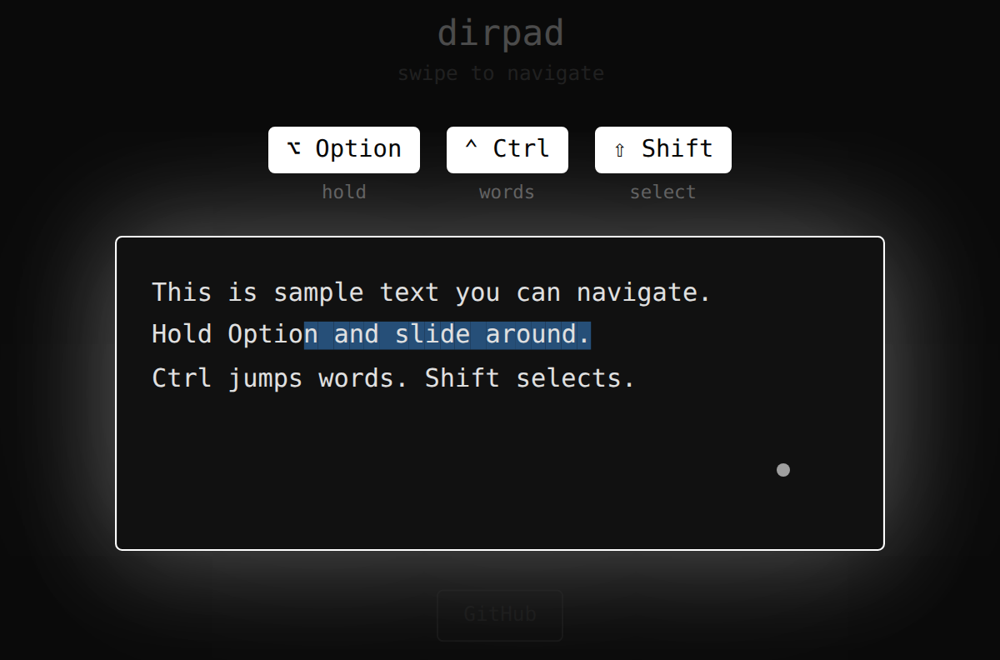

fzf, autocomplete, file pickers, vim. Every fast-CLI workflow eventually becomes "press the arrow key 47 times," while the trackpad sits there with way more bandwidth than four keys. [Dirpad](https://github.com/sryo/dirpad) lets it talk to apps in a language they already speak: arrow keys.

## What it does

- Hold the trigger key (Option by default) and slide the trackpad: the movement becomes arrow key presses, in any app.
- Add Control to jump by word, Shift to select, or both.
- Runs in the background with no Dock icon; each step can tick the trackpad's haptics.
- Trigger key, sensitivity, axes and default mode are set with `defaults write`.

## Screens

## How it works

DIAGRAM: diagram.svg "Pointer moves go in, arrow keys come out, and the cursor stays where it was"

A CGEvent tap watches pointer moves and modifier changes. While the trigger is held, Dirpad adds up the movement, and each time it crosses a threshold set by sensitivity (vertical takes twice the distance) it posts one arrow key, with Option for word jumps and Shift for selection. The original move is dropped and the cursor warped back.

## Details

- Swift in a single file, Apple frameworks only (Cocoa, ServiceManagement, UserNotifications)
- macOS 15.1+, needs Accessibility permission to read and post events
- Offers to move itself to /Applications, then registers as a login item
- Settings live in UserDefaults under `com.sryo.dirpad`
