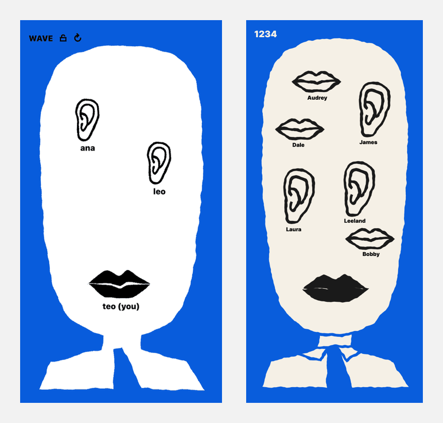
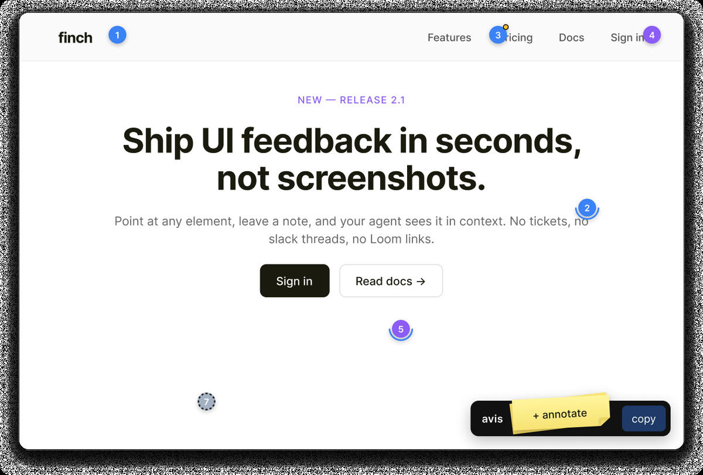
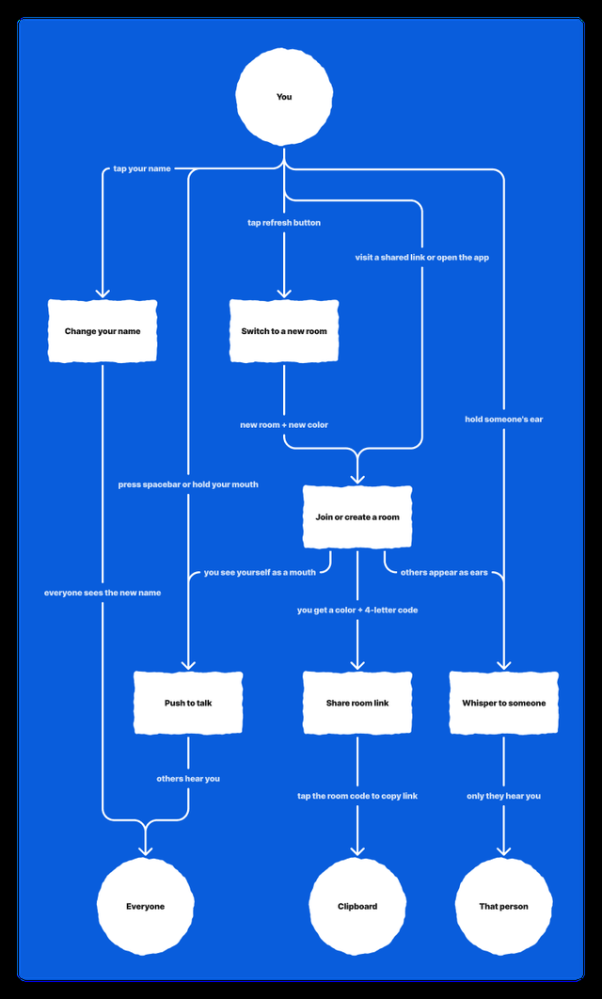

I got tired of inheriting Figma files that lied about what shipped. Components moved on, the canvas didn't, and the next designer started from fiction. [Figma-CDP](https://github.com/sryo/figma-cdp) makes the canvas catch up to the build.

## What it does

- Builds Figma mockups from code or plain English: paste HTML, describe a screen, or hand Claude a SwiftUI view.
- Edits what's already there: copy, layouts, effects, components.
- Imports a public web page as editable layers.
- The reverse of Figma MCP: changes land in the Figma file you have open, while you watch.

DIAGRAM: diagram.svg "Ask for a change, it reads the code, saves a version and updates the frame you have open"

## Screens

## Decisions

### The code is the truth

I chose to make the canvas follow the code. Components move on and the canvas doesn't, so it reads the real source first and redraws the frame to match what's built.

### The live page, not a screenshot

Importing a web page used to mean redrawing it from a screenshot. That was the slow path. Now it reads the live page itself, and the layers come out editable, with real text.

### Save a version before touching anything

Before any change, it saves a named point in the file's version history. Undo can't back out an agent's whole job. Restoring that version can.
