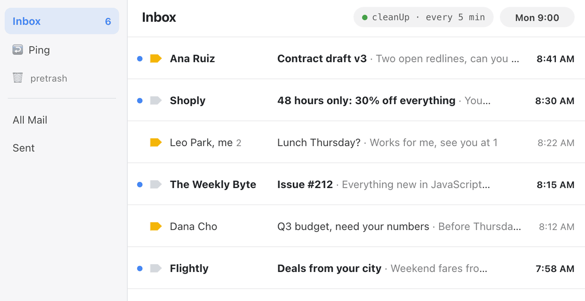
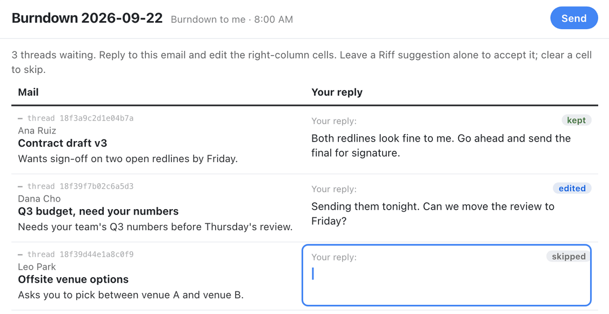

Threads I meant to answer kept sinking under promos I never read, so I wrote [GmailTidy](https://github.com/sryo/GmailTidy) to do the sorting I was doing by hand.

## What it does

- **Hot** and **Meh**. Read mail leaves the inbox after a day. Newsletters and promos wait in 🗑️ pretrash for 20 days, then go to Trash.
- **Ping**. A thread you haven't answered in 2 to 4 days comes back once, with a draft.
- **Bunch** and **Stash**. Important threads get a label per sender domain; attachments get their own shelf.
- **Riff**, **Burndown**, **Public** (opt-in). Replies in your voice, a daily digest mail, a thread published as a page.

DIAGRAM: diagram.svg "Read mail leaves, promos wait in pretrash, unanswered threads come back, and you reply once"

## Screens

## Decisions

### Pretrash before trash

I chose a holding label over deleting. Promos and newsletters skip the inbox and wait in 🗑️ for 20 days before they reach Trash. Star or reply and the thread stays. Mail from people you've written to is never touched.

### A ping comes back once

A thread you haven't answered comes back to the inbox one time, with a draft reply already in it. Remove the label to dismiss it. It won't be pinged again.

### One mail a day, not a pile of chores

Unanswered mail piles up because each thread is its own chore. Burndown gathers them into one morning mail, each with a suggested reply. I answer that one mail, and every thread gets its draft.
