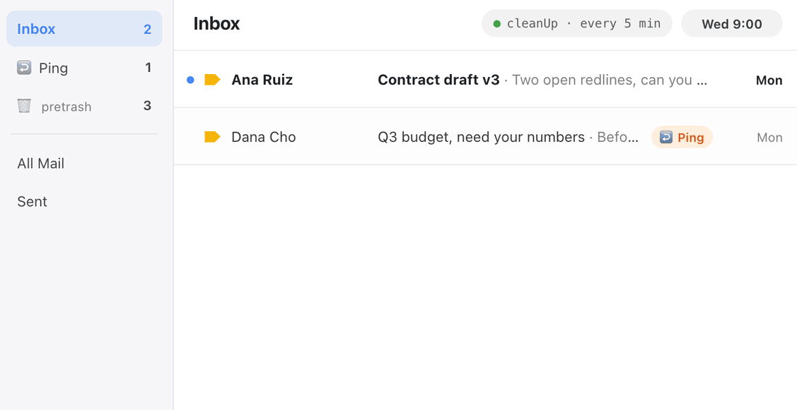

Threads I meant to answer kept sinking under promos I never read, so I wrote [GmailTidy](https://github.com/sryo/GmailTidy) to do the sorting I was doing by hand.

## What it does

- **Hot** and **Meh**. Read mail leaves the inbox after a day. Newsletters and promos wait in 🗑️ pretrash for 20 days, then go to Trash.
- **Ping**. A thread you haven't answered in 2 to 4 days comes back, once, with a draft reply.
- **Bunch** and **Stash**. Important threads get a label per sender domain; attachments get their own shelf.
- **Riff**, **Burndown**, **Public** (opt-in). Replies in your voice, a daily digest mail, a labeled thread published as a page.

## Screens

## How it works

DIAGRAM: diagram.svg "The passes that touch mail search Gmail and write back; only the slow ones call Gemini"

Everything runs on time triggers. `install()` creates the labels, a tracking sheet and the triggers. `cleanUp` is the fast pass, `bunch` files by domain, `cleanUpDeep` drafts Riff replies and reads Burndown answers, and `sendBurndown` mails the morning digest. Every rule is a Gmail search you can inspect.

## Details

- Google Apps Script (V8) with Gmail's Advanced Service, pushed with clasp
- Replies drafted by Gemini from sent mail you label 🫵 Voice; needs a `GEMINI_API_KEY`
- Reversible by default: pretrash before trash, and mail from people you've written to is never touched
- Public is a `doGet` web app that serves the 🌎 Public label as a page
- GPL-3.0
