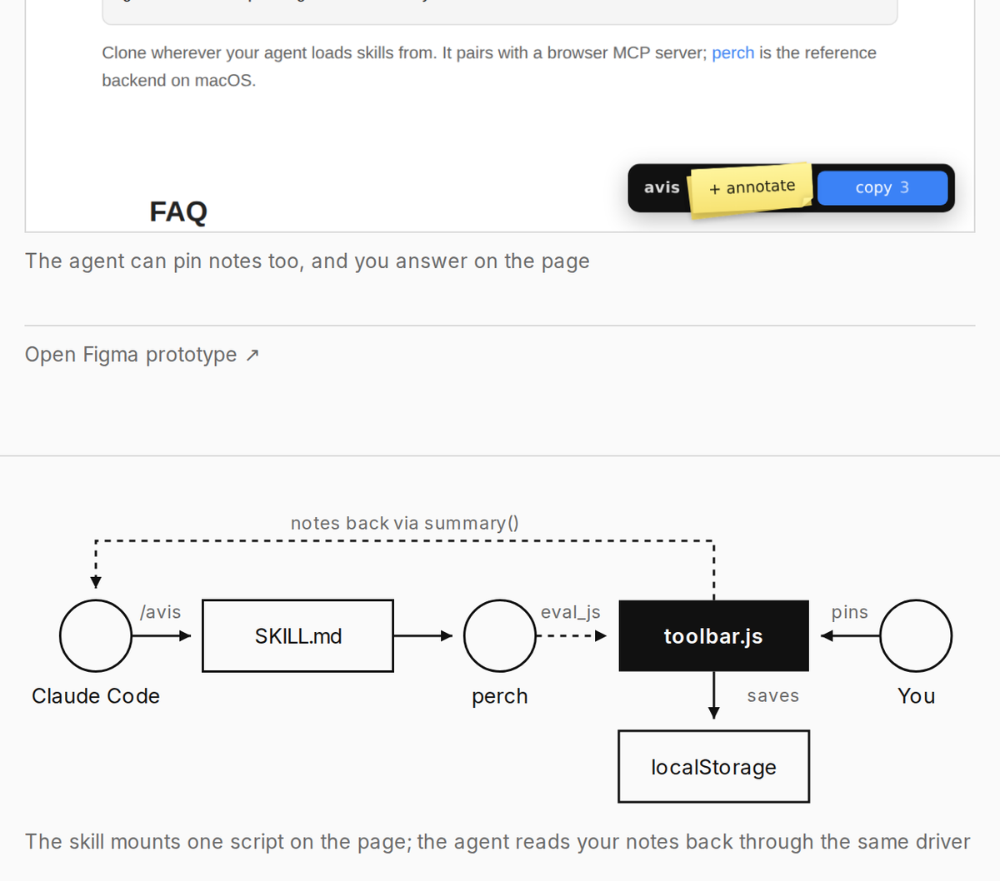

Why is it so hard to keep a portfolio updated? Perfectionism is just a fancy word for [All or Nothing](https://untested.sonnet.io/notes/perfectionism-is-fight-or-flight/): obsess over every detail or run from the work, and either way ship nothing. [LineAndForm](https://github.com/sryo/sryo.github.io) is my padded room: an imperfect tool for an imperfect creator.

## What it does

- One folder per project: a `_.md` with frontmatter and an optional `_.svg` glyph (else the label's initial stands in).
- `bash build.sh` writes `works.html`, a dated ledger, and one page per project.
- Plain lines become page parts: `## ` headings, `METRICS:` figures, captioned screens, inline diagrams.
- A duplicate slug or missing field stops the build; off-spec glyphs and heavy screens get warnings.

## Screens

## How it works

DIAGRAM: diagram.svg "Folders go in, one bash script runs, static pages come out"

One awk pass reads the frontmatter; each page inlines the stylesheet and script. `work/` is wiped first, so deleted folders leave no trace. The constraints are the features: every decision I removed was one less reason to procrastinate.

## Details

- Bash with awk, sed and od; no databases, no packages. Static HTML on GitHub Pages
- Image sizes read from PNG, GIF and JPEG headers with `od`, so pages don't jump
- Fixture builds diffed against expected HTML, plus Playwright checks on desktop and phone
- `build.sh -d` deletes the script once it's done
- License: use it, change it, share it, no liability
