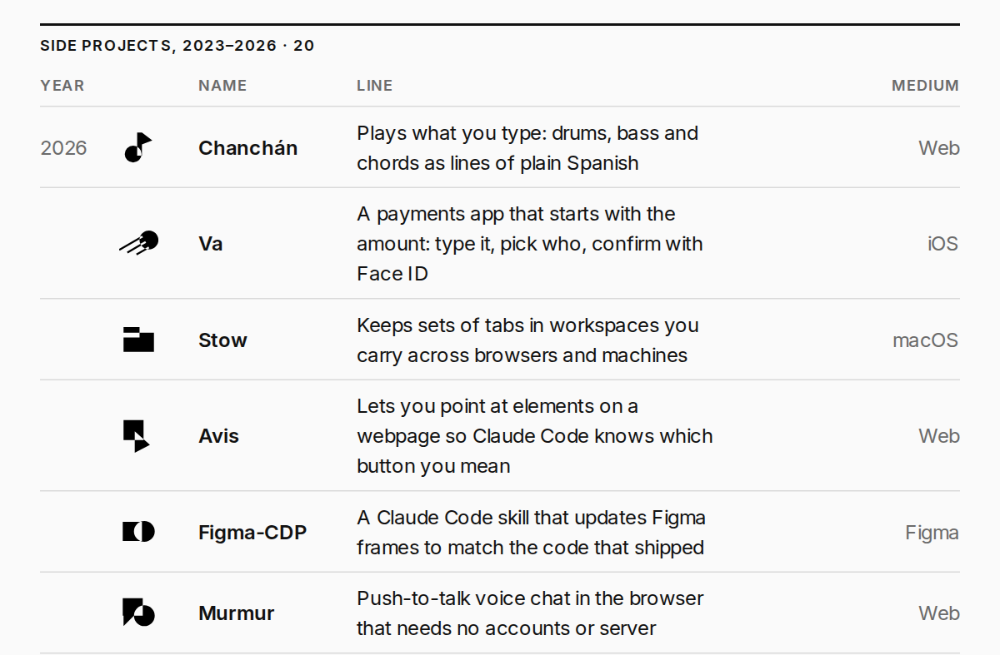

Why is it so hard to keep a portfolio updated? Perfectionism is just a fancy word for [All or Nothing](https://untested.sonnet.io/notes/perfectionism-is-fight-or-flight/): obsess over every detail or run from the work, and either way ship nothing. [LineAndForm](https://github.com/sryo/sryo.github.io) is my padded room: an imperfect tool for an imperfect creator.

## What it does

- One folder per project: a Markdown file with frontmatter and an optional glyph (else the label's initial stands in).
- One command writes a dated ledger and one page per project.
- Plain lines become page parts: headings, figures, captioned screens, inline diagrams.
- A duplicate slug or missing field stops the build; off-spec glyphs and heavy screens get warnings.

DIAGRAM: diagram.svg "Add a folder, run one script, and it becomes a row in the ledger and a page of its own"

## Screens

## Process

Until August 2024 the portfolio was one page I edited by hand. Then I rewrote it as a script that builds the site from folders. No databases, no complex build pipelines, no excuses.

Then came review rounds, in September 2026. The home page was a ring of big animated glyphs. It became a dated ledger with one page per project, and only the glyph's jump from row to page stayed. A soft, detailed set of glyphs was thrown out; every icon is now a few basic shapes cut out of each other.

Side projects then got architecture diagrams and stack lists. I threw those out: they showed engineering, not design. What came back was the old whimsy: a rope that hangs between ledger rows, glyphs that pull apart, a pulse that runs through each diagram.
