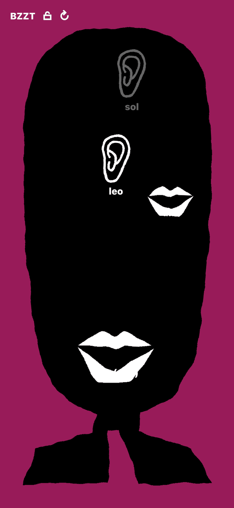

I wanted push-to-talk that didn't need accounts or a server. [Murmur](https://sryo.github.io/murmur/).

## What it does

- Opening it gives you a room with a 4-character code; tap the code to copy a link anyone can join with.
- Hold your mouth to talk to the room, or hold Space on desktop.
- Hold someone's ear to whisper: only they hear you, everyone else gets silence.
- The room's creator can lock it, so newcomers knock and wait to be let in.

Share the code, hold your mouth to talk, see an ear turn into a mouth, hold an ear to whisper.

## Screens

Visual design inspired by [Kenneth Andersson](https://www.kennethandersson-studio.com/).

<iframe style="border: 1px solid rgba(0, 0, 0, 0.1);" width="100%" height="450" src="https://embed.figma.com/design/eOXc6DlXfRDsSWi8HPwqLj/Murmur?node-id=0-1&embed-host=share" allowfullscreen></iframe>

## Decisions

### One face for the whole room

There's no list of people. Every chat is a list; this one doesn't have to be. The room is one paper-cut face. Your mouth sits low in the middle, and everyone else is an ear around it. When someone talks, their ear turns into a moving mouth.

### Hold to talk, never an open mic

I wanted push-to-talk, not an open mic. Your mic stays off until you hold your mouth, or Space on a desktop, and goes off again when you let go.

### Whisper by holding an ear

A private word uses the same gesture as talking, aimed at one ear. The ear is the person, so there's no name to pick from a menu.
