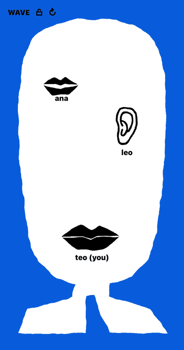

I wanted push-to-talk that didn't need accounts or a server. [Murmur](https://sryo.github.io/murmur/).

## What it does

- Opening it gives you a room with a 4-character code; tap the code to copy a link anyone can join with.
- Hold your mouth to talk to the room, or hold Space on desktop.
- Hold someone's ear to whisper: only they hear you, everyone else gets silence.
- The room's creator can lock it, so newcomers knock and wait to be let in.

## Screens

<iframe style="border: 1px solid rgba(0, 0, 0, 0.1);" width="100%" height="450" src="https://embed.figma.com/design/eOXc6DlXfRDsSWi8HPwqLj/Murmur?node-id=0-1&embed-host=share" allowfullscreen></iframe>

## How it works

DIAGRAM: diagram.svg "Relays only introduce the browsers; voice goes peer to peer, and a whisper swaps in silence"

Browsers find each other through public Nostr relays with Trystero; the relays carry the handshake, never audio. Your mic track stays off until you hold. A whisper replaces your track with a silent one for everyone but the target.

## Details

- Plain JavaScript modules and lit-html, no build step; Trystero vendored for WebRTC over Nostr
- Installable web app with a service worker that caches the shell
- A weekly GitHub Action checks the relays and refreshes `relays.json`
- Open source under a short custom license: use it, change it, share it
- Visual design inspired by [Kenneth Andersson](https://www.kennethandersson-studio.com/)
