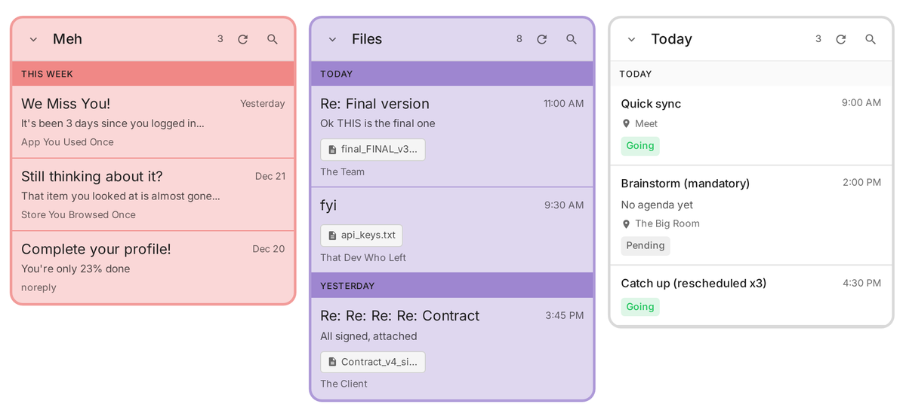
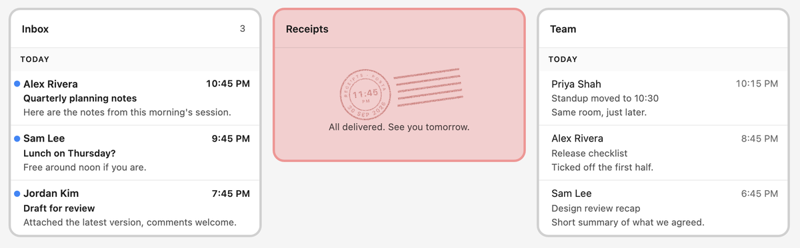

Email processing is parallel, but Gmail gives me one list and one scroll. [Posta](https://sryo.github.io/Posta/) lays the inbox out like a Kanban board instead. I'm not trying to replace Gmail, just make it less overwhelming for how I actually use email.

## What it does

- Every card is a saved Gmail search behind a simple label, shown as its own column; drag cards to reorder the board
- Calendar cards (`calendar:today`, `calendar:week`) sit next to mail, filtered by organizer, location or attendees
- Select several threads and reply to all of them at once; hover a thread to archive, star, reply or delete
- Connect every Gmail account and switch between them instantly

All the cards in view at once: urgent first, work threads in one reply, newsletters later.

## Screens

<iframe style="border: 1px solid rgba(0, 0, 0, 0.1);" width="100%" height="450" src="https://embed.figma.com/design/DT81TTh16DyX61w01ThWh0/Posta?node-id=6-438&embed-host=share" allowfullscreen></iframe>

## Decisions

### Columns, not one list

I chose a board of columns over Gmail's single list. I don't read email in one pass: I scan for what's urgent, batch the work threads and leave newsletters for later. Each of those gets its own column.

### Cards named for what you do

The default board isn't Inbox, Sent and Drafts. It's Hot, Ping, Waiting, Meh and Stash: important mail until you read it, threads you read and never answered, mail you're waiting on, the noise, the files. Everything else is folded away. Gmail piles up mail you'll never read. Posta sorts it so you know what you don't need to read.

### An empty card gets a postmark

A card you've cleared isn't a grey inbox icon. It's stamped with a postmark in the card's colour, dated with when it cleared. A search that finds nothing is stamped Return to sender.
