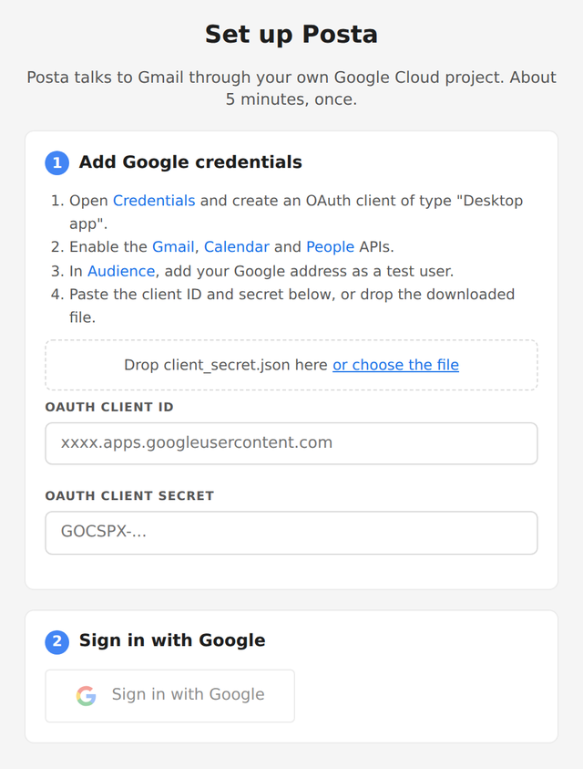

Email processing is parallel, but Gmail gives me one list and one scroll. [Posta](https://sryo.github.io/Posta/) lays the inbox out like a Kanban board instead. I'm not trying to replace Gmail, just make it less overwhelming for how I actually use email.

## What it does

- Every card is a saved Gmail search behind a simple label, shown as its own column; drag cards to reorder the board
- Calendar cards (`calendar:today`, `calendar:week`) sit next to mail, filtered by organizer, location or attendees
- Select several threads and reply to all of them at once; hover a thread to archive, star, reply or delete
- Connect every Gmail account and switch between them instantly

## Screens

<iframe style="border: 1px solid rgba(0, 0, 0, 0.1);" width="100%" height="450" src="https://embed.figma.com/design/DT81TTh16DyX61w01ThWh0/Posta?node-id=6-438&embed-host=share" allowfullscreen></iframe>

## How it works

DIAGRAM: diagram.svg "A card is a query; the Rust core runs it against Google and caches what comes back"

The SolidJS board calls Tauri commands with each card's query. The Rust core runs it against the Gmail, Calendar and People APIs, keeps threads and each account's history id in SQLite, and later asks Gmail only for what changed. On macOS the card layout syncs through iCloud; Gemini suggests replies when you add a key.

## Details

- Tauri 2 desktop app: SolidJS and TypeScript front end, Rust back end
- Builds for macOS (signed and notarized), Windows and Linux, from GitHub Releases
- Incremental sync from Gmail's history id instead of refetching every card
- OAuth tokens kept in the system keychain
