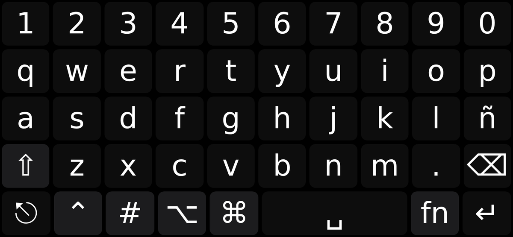
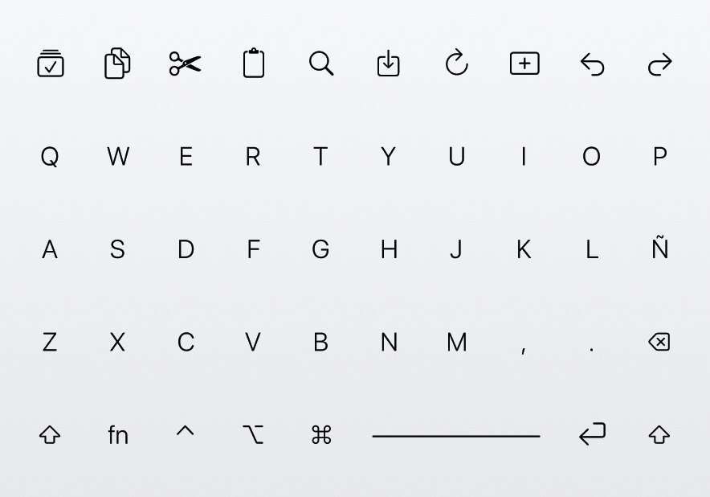

I keep a folder of small things macOS does wrong, and another of the Hammerspoon scripts I write to fix them. The second folder is [Spoons](https://github.com/sryo/Spoons).

## What it does

- **Windows that look after themselves.** [WindowScape](https://github.com/sryo/Spoons/tree/main/WindowScape) tiles them, [FrameMaster](https://github.com/sryo/Spoons/blob/main/FrameMaster.lua) puts actions in screen corners, [WanderFocus](https://github.com/sryo/Spoons/blob/main/WanderFocus.lua) activates whatever you hover.
- **A pointer that meets you halfway.** [BubbleCursor](https://github.com/sryo/Spoons/blob/main/BubbleCursor.lua) clicks the nearest target, [SideSwipe](https://github.com/sryo/Spoons/blob/main/SideSwipe.lua) puts volume and brightness on the trackpad edges.
- **Input from anywhere.** [CloudPad](https://github.com/sryo/Spoons/tree/main/CloudPad) makes your phone a keyboard, [ForceKeys](https://github.com/sryo/Spoons/blob/main/ForceKeys.lua) maps one onto the trackpad, [Sssssssscroll](https://github.com/sryo/Spoons/tree/main/Sssssssscroll) scrolls when you hiss.
- **Safety nets.** [UndoClose](https://github.com/sryo/Spoons/blob/main/UndoClose.lua) brings an app back within five seconds of Cmd‑Q, [DigUp](https://github.com/sryo/Spoons/tree/main/DigUp) makes everything you've seen searchable.

## Screens

<iframe style="border: 1px solid rgba(0, 0, 0, 0.1);" width="100%" height="450" src="https://embed.figma.com/design/lwAZSKDkXO89Niyq3i6SoS/Spoons?node-id=2008-185&embed-host=share" allowfullscreen></iframe>
