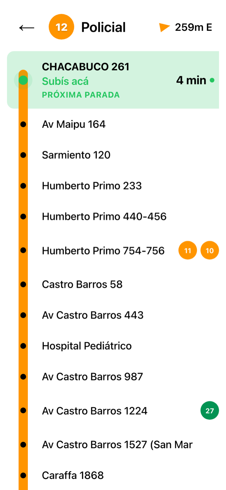
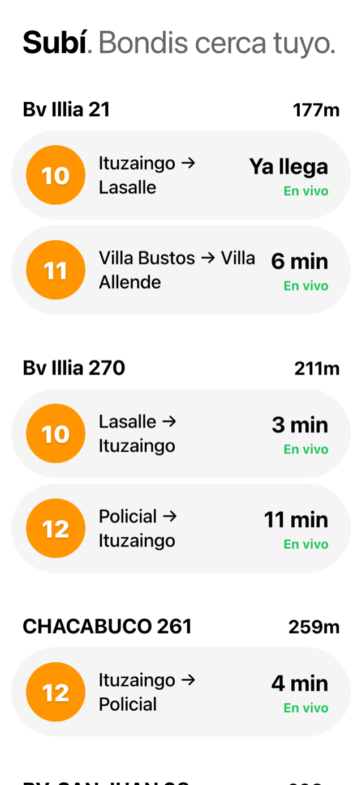

I just want to know if the bus is coming. Córdoba's official tracker, TuBondi, works, but it feels like it was designed by committee in 2012.

Subí ("get on" in Argentine Spanish) is an alternative frontend that pulls from the same data but presents it differently. Real-time arrivals, a cleaner map, and a schematic view that turns spaghetti routes into something readable. [Subí](https://github.com/sryo/subi-app).

## Screens

