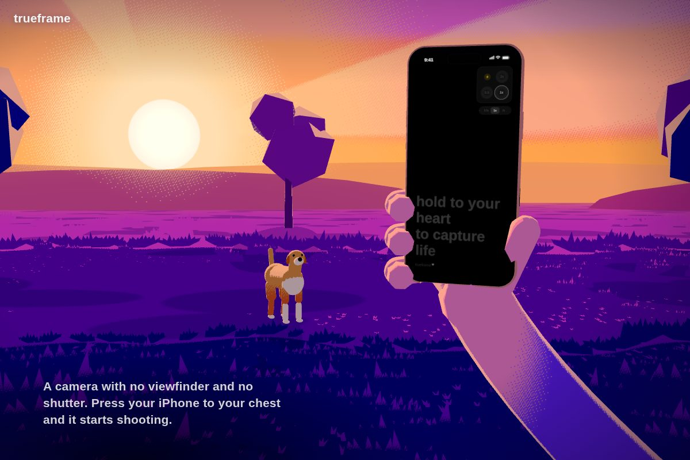

In Spanish, "recordar" (to remember) comes from "re-cordis", to pass through the heart again. [Trueframe](https://sryo.github.io/Trueframe/) takes that literally: a camera with no viewfinder and no shutter, so you're present in the scene instead of behind a screen.

## What it does

- Press the phone to your chest to cover the proximity sensor; a burst begins.
- Every photo lands in your hand as a heartbeat, so you never have to look down.
- Lift it, and only the good frames reach your library.
- If nothing passes, it still keeps the single best shot.

DIAGRAM: diagram.svg "Hold it to your chest, feel each shot, lift, and only the good photos reach your library"

## Screens

<iframe style="border: 1px solid rgba(0, 0, 0, 0.1);" width="100%" height="450" src="https://embed.figma.com/design/YDxcgwNpQlv32skv0rmewP/TrueFrame?node-id=0-1&embed-host=share" allowfullscreen></iframe>

## Process

The first version, in January, also shot video and Live Photos, with quality settings and smudge detection. In June I cut all four. It was too much. Now it only takes photos.

Then I tuned the feel. One heartbeat now answers the press, before the first photo. Each shot waits briefly for a still moment between your steps and breaths. At rest, the heart on the home screen beats at 52 bpm, a little brighter on full-moon nights.

Last came the ending. The kept photos fan out and fall into the heart, which beats as each one lands. I tried letting the rejected ones swing past and get flung away, then threw that out. Showing only what you kept is better.
