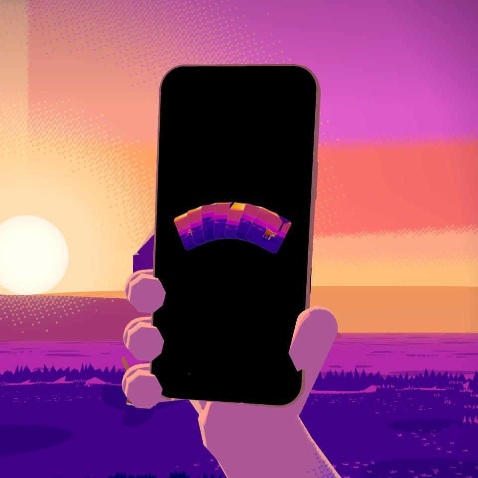

In Spanish, "recordar" (to remember) comes from "re-cordis", to pass through the heart again. [Trueframe](https://sryo.github.io/Trueframe/) takes that literally: a camera with no viewfinder and no shutter, so you're present in the scene instead of behind a screen.

## What it does

- Press the phone to your chest to cover the proximity sensor; a burst begins.
- Every photo lands in your hand as a heartbeat, so you never have to look down.
- Lift it, and Vision scores every frame on the device; anything below the aesthetics threshold never reaches your library.
- If nothing passes, it still keeps the single best shot.

## Screens

<iframe style="border: 1px solid rgba(0, 0, 0, 0.1);" width="100%" height="450" src="https://embed.figma.com/design/YDxcgwNpQlv32skv0rmewP/TrueFrame?node-id=0-1&embed-host=share" allowfullscreen></iframe>

## How it works

DIAGRAM: diagram.svg "The proximity sensor is the shutter; Vision decides what reaches Photos"

One coordinator owns the session. Covering the sensor starts the burst; each shot plays a heartbeat. Up to 50 photos; three pitch-black frames in a row, as in a pocket, end it. On lift, Vision rates every frame, the policy keeps those at 0.4 or above, and LibrarySaver writes them to Photos.

## Details

- Swift 6 and SwiftUI, iOS 26 or later, iPhone only, dark UI
- AVFoundation burst with responsive capture, deferred photo delivery and fast capture prioritization, up to 24 MP
- Vision's image aesthetics request scores every frame on the device
- Back lens (ultra wide, wide, telephoto), flash and interval from 0.25 to 5 seconds
- Source on GitHub under a short custom license; unit tests run on fakes for the camera, sensor, haptics and library
