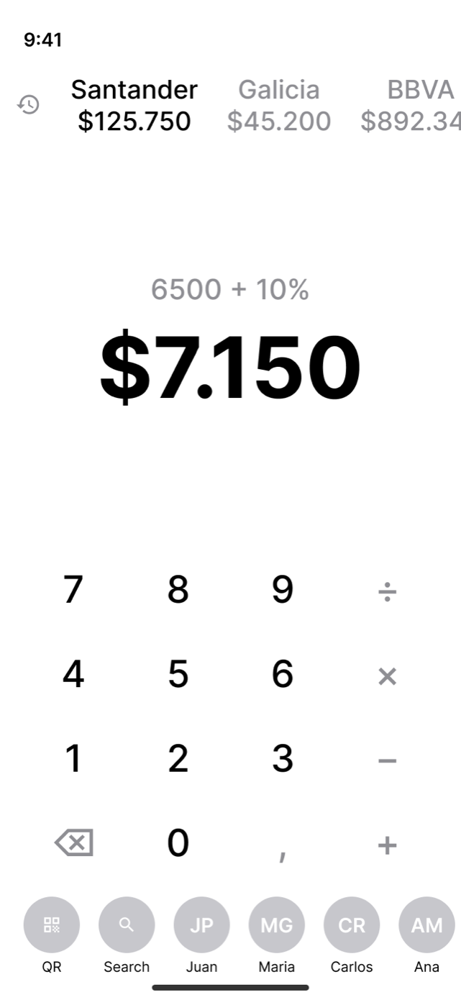
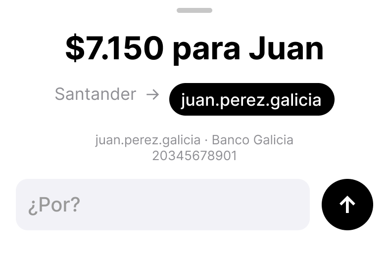

Every banking app makes me pick an account before it'll let me say what I'm doing. That's backwards: you start with how much. Va (as in "la plata va y viene", money comes and goes) puts the amount first.

<iframe style="border: 1px solid rgba(0, 0, 0, 0.1);" width="100%" height="450" src="https://embed.figma.com/design/B8WDea0oPFVkyikdojYyfT/Va?node-id=0-1&embed-host=share" allowfullscreen></iframe>

## What it does

- Type what you're sending, pick who gets it, confirm with Face ID: three taps
- Compresses every traditional banking flow into one screen
- Moves real money between your bank accounts
- Leaves out balance displays, transaction graphs and feature creep: a calculator that happens to move money

DIAGRAM: diagram.svg "Type the amount, pick who, confirm with Face ID, and the money moves"

## Screens

## Decisions

### Amount first, account later

I chose to start with the amount, not the account. Va asks how much, then to whom, then Face ID.

### A calculator, not a dashboard

There are no balances and no transaction graphs. One screen does what a banking app spreads over many. I'm still testing whether this works better or if I've over-simplified.
