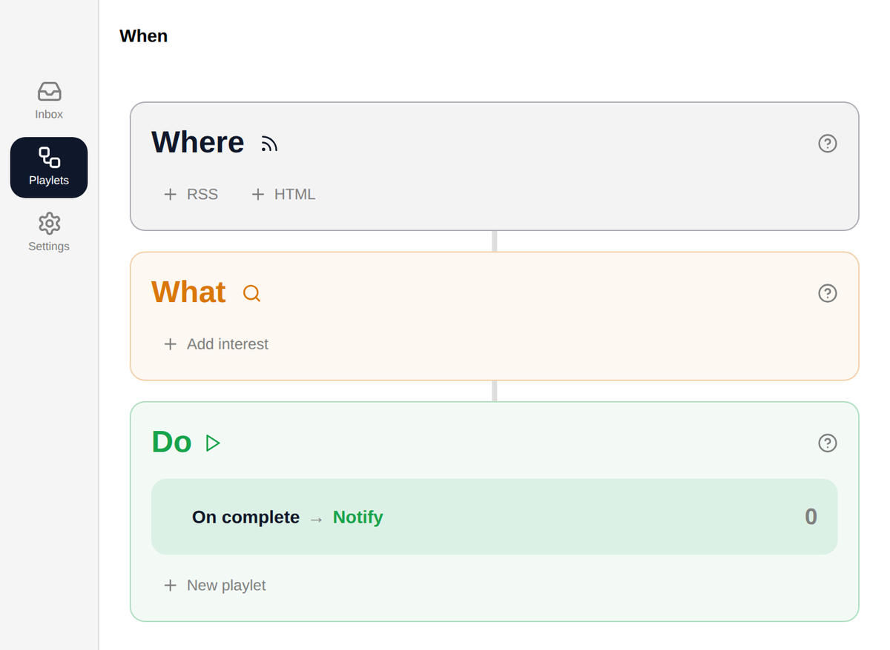

I got tired of checking if the thing I wanted was out yet. [When](https://github.com/sryo/whenThen) monitors feeds and lets me know when something new lands. Simple rules handle the rest: notify me, organize files, queue for later.

## What it does

- Checks RSS and HTML sources for what you told it you want, and drops matches into an inbox to approve.
- Downloads what you approve, plus any .torrent file dropped into a watched folder.
- Playlets are when→then rules: when a torrent is added or finishes and its name or size matches, run a chain of actions.
- Actions cast to a Chromecast, move files, fetch subtitles, notify, call a webhook or run a script.

## Screens

<iframe style="border: 1px solid rgba(0, 0, 0, 0.1);" width="100%" height="450" src="https://embed.figma.com/design/Ti2K34uKdUce6cX9JxUOZ4/whenThen?node-id=32-13&embed-host=share" allowfullscreen></iframe>

## How it works

DIAGRAM: diagram.svg "Feeds fill an inbox; once a download finishes, playlets decide what happens to it"

A Rust service polls each source on a timer and queues items that match an interest. Approving one hands it to librqbit. Download events reach the Svelte side, where matching playlets run their actions in order. To cast, a local Axum server streams the file to the TV.

## Details

- Tauri 2 desktop app: Svelte 5, TypeScript and Tailwind on top of Rust
- librqbit for torrents, rust_cast and mDNS for Chromecast, OpenSubtitles for subtitles
- Feed checks use ETag and Last-Modified caching and back off exponentially, up to 30 minutes, when a source fails
- Built for Apple Silicon Macs by a GitHub Actions workflow; the version is the build date
- Archived: the when→then idea lives on in [Fonte](https://github.com/sryo/fonte)
