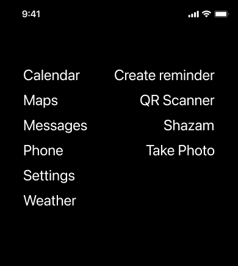

I started replacing my iOS home screen icons with verbs. "Pay" instead of a bank app, "Set Timer" instead of the clock. [ZenTrate](https://github.com/sryo/scriptables) is the set of Scriptable widgets that came out of it, inspired by old point-and-click adventure games.

## What it does

- A home screen widget lists your actions as words in up to three columns; each opens an app, a Shortcut or any URL scheme.
- The more you tap an item, the bigger its text gets. Sort by hand, alphabetically or by use.
- Items can show only at certain hours or on certain days.
- ZenTweak edits the list from the widget itself; ZenLendar, ZenDigest and ZenTheme share the same look.

DIAGRAM: diagram.svg "Glance at the home screen, tap “Pay”, the bank app opens, and “Pay” grows a little"

## Screens

## Decisions

### Words, not icons

I chose words over icons. The home screen says what I want to do, "Pay" or "Set Timer", not which app does it. The idea came from old point-and-click adventure games, where you pick the verb first.

### Words that grow with use

Every tap makes that word a little bigger. Nothing moves, so muscle memory still works. The things you use most end up the largest on the screen. You can still sort by hand, alphabetically or by use.

### Words that keep hours

An item can show only at certain hours or on certain days. Outside them, it's not on the screen at all.
