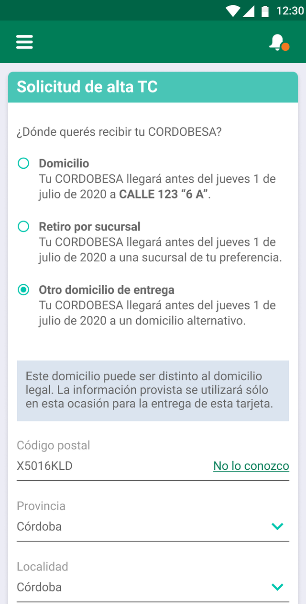
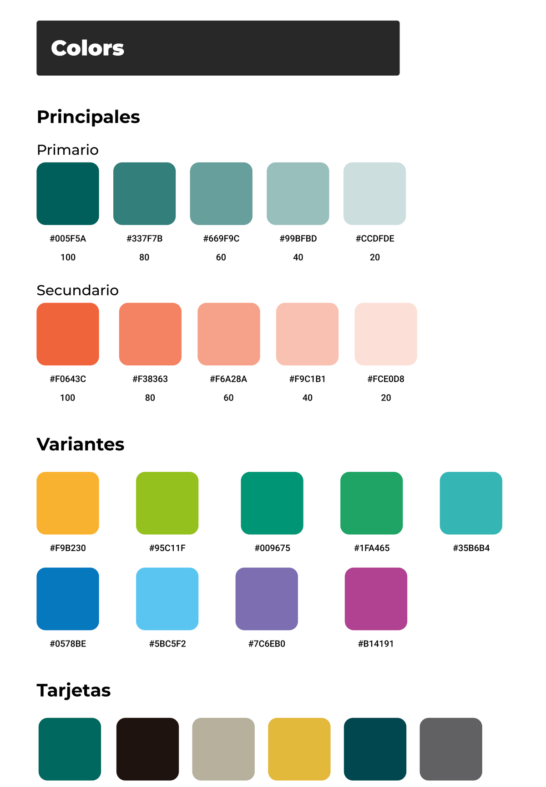

<iframe title="Bancor crisis features walkthrough" src="https://youtube.googleapis.com/embed/?autohide=1&ps=docs&enablecastapi=0&hl=en&partnerid=30&post_message_origin=https://drive.google.com&origin=https://drive.google.com&hbenv=apps-elements&enablejsapi=1" frameborder="0" allowfullscreen></iframe>

[Video (Google Drive)](https://drive.google.com/file/d/1gekSKbQl82T0MtQsx0baiyesIURSF_40/view?usp=sharing)

## Context

Banco de Córdoba, the provincial bank, suddenly had to deliver emergency relief to people who had never had an account. The government's IFE program would pay over 600,000 residents, many of them unbanked, and with the branches closed the only way to reach them was through a phone.

We worked around the clock. The goal was simple: get people their money. If we failed, families wouldn't eat.

## My role

I was Product Owner and design lead for Bancón, the bank's home banking app. I designed the crisis features, then the 2021 modernization, and proposed the bank's first design system so first-time digital users could actually use the platform.

## Decisions

### Logical accounts instead of paperwork

Years of digital progress needed to happen in a week, so we cut anything non-essential and chose speed over rigor, with calculated risks.

Traditional onboarding was too slow. We worked with backend to create "logical accounts" for unbanked citizens without the usual paperwork, so someone with only a phone could open one. This let us open ~380,000 new accounts remotely.

Customers stuck in quarantine couldn't receive cards at their registered address. I designed "Dónde está mi tarjeta" to track card delivery and send it to a second address, and a virtual card to transfer and pay with before the physical one arrived. Support calls dropped during the pandemic.

DIAGRAM: onboarding.svg "A phone was enough to open an account; in quarantine, you could track the card or use it early"

### Peperina: the design system

I proposed and convinced management to fast-track Peperina, the bank's first design system. With 15 developers across multiple vendors shipping features simultaneously under deadline pressure, we needed a way to keep the interface consistent without constant coordination.

Peperina was a tested, documented component library across web and mobile. Developers could grab what they needed and build. I also wrote the two documents they built from: a Digital Experience Design Guide for Non-Designers and a Map for Service Design Cells. When someone added a new screen, it looked like it belonged. That first iteration became the foundation the team evolved later.

DIAGRAM: peperina.svg "One library and two guides let 15 developers ship web and mobile without constant coordination"

## Outcome

METRICS:
- **418%** increase in app transactions
- **680K** users (doubled from 360K)
- **380K+** new accounts created
- **81%** increase in pensioner usage

Once people were forced to try digital banking, many of them kept using it. Then virtual wallets started taking the everyday transactions, so through 2021 I modernized the app against them: 845,000 individuals and 18,200 companies on the app, 68,400 newly onboarded. I streamlined the most-used flows for its four audiences (older adults, public employees, students and business owners) across multiple rounds of testing.

CTA: Navigating a digital transformation or crisis response? [Let's talk](https://www.linkedin.com/in/myadarola/).
