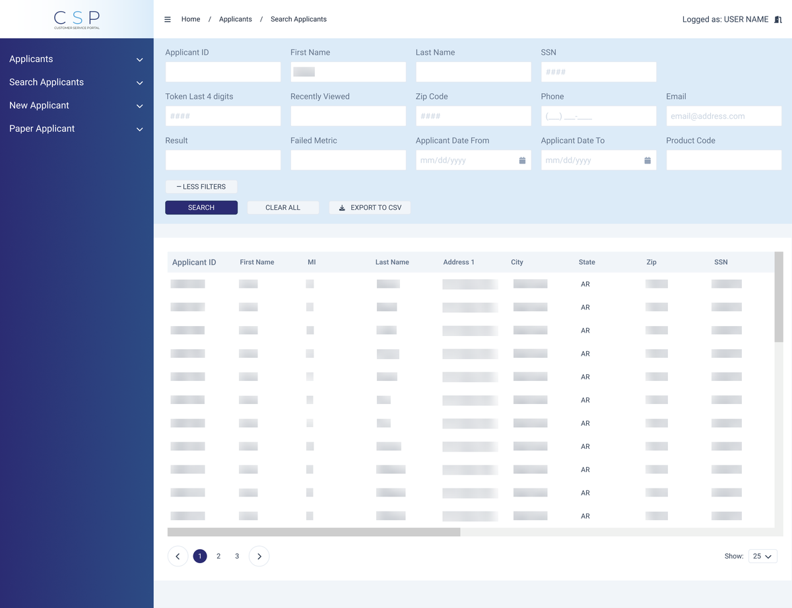
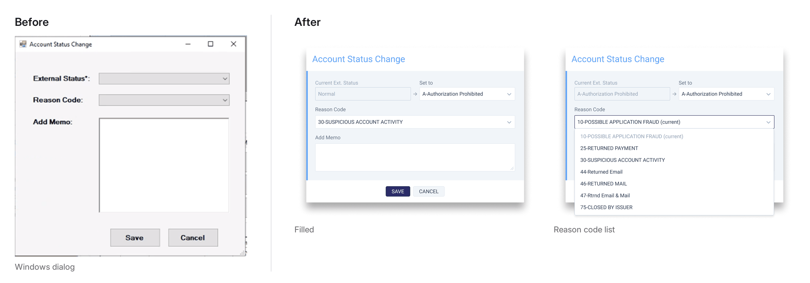
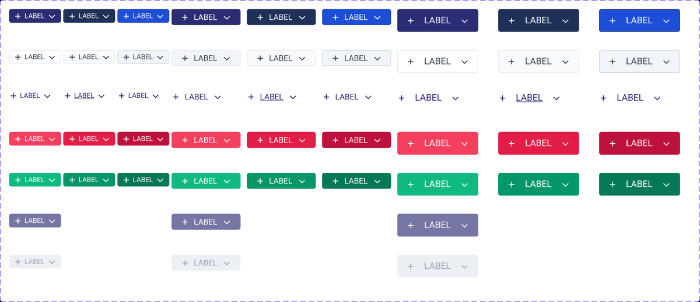

## Context

Continental Finance serves cardholders with poor credit. They needed a mobile banking app built for low-literacy and first-time users. Behind the app, the company's own teams needed admin tools to run it.

## My role

I was Lead UX/UI Designer through Allata, from July 2022 to May 2024: the cardholder app, the internal admin tools, and the component library under both.

## Decisions

### Clarity first, to WCAG

I designed the app for clarity and confidence, built to WCAG for low-literacy and first-time users.

The agent console got the same care. A task asks its questions in order, and the answer decides what comes next: a help note, an extra field, or a block that says why the change can't go through and what to tell the cardholder. Status changes show the current value next to the new one.

### Denser screens, not more whitespace

Agents worked in old Windows tools: grey dialogs, one per task. I rebuilt them one by one in the web console.

I ran research with support agents and cardholders. The support agents killed our whitespace: they wanted denser screens, not more scrolling. So we rebuilt for density, and added filters that made the agents measurably faster.

DIAGRAM: research.svg "Support agents asked for density over scrolling; denser screens and filters came out of it"
TOY: airy-dense

### One accessible library under everything

The cardholder app and the admin tools were built on one accessible component library with keyboard and contrast standards. The admin tools set access by role.

DIAGRAM: system.svg "One accessible component library under the cardholder app and the role-based admin tools"

## Outcome

METRICS:
- **100+** screens shipped
- **Admin tools** with role-based access
- **Faster** support agents, after research-led filters

CTA: Designing for people new to digital banking? [Let's talk](https://www.linkedin.com/in/myadarola/).
