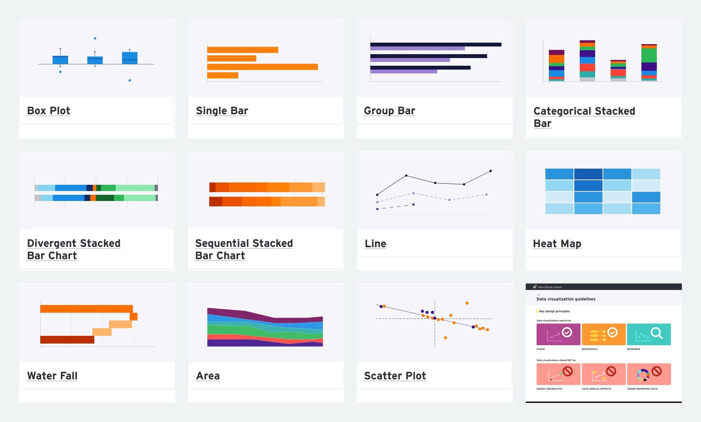
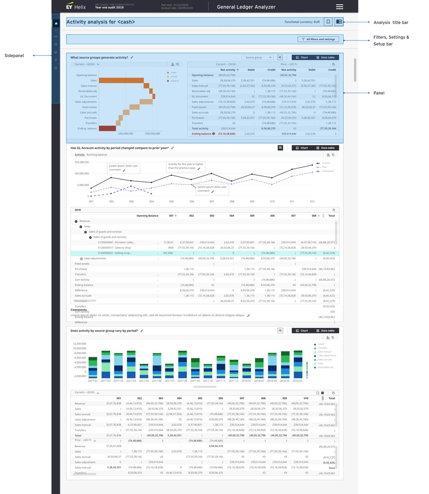
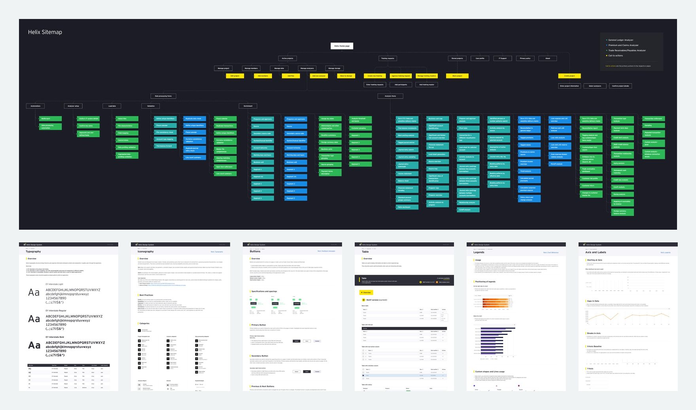

## Context

Helix is EY's global audit analytics platform: a library of analyzers that auditors worldwide run across a client's operating cycle. The work was to bring it onto Motif, EY's design system. Helix was legacy and couldn't change much, so we tweaked it until it looked and worked like Motif, without retraining the auditors who use it.

## My role

Lead UX Designer through Cognizant Softvision, from November 2021 to July 2022, and Community Lead for the design team.

## Decisions

### Auditors' workflows before patterns

I interviewed auditors to ground the redesign, then iterated the data-presentation patterns against their real workflows.

### Written guidelines for Helix visualizations

I authored the Motif Guidelines for Helix Visualizations: color, typography and iconography standards. They didn't stay inside Helix; EY's other audit analytics tools adopted them too.

### One architecture for a team of ten

I coordinated a team of ten designers alongside Product, Content and Business Development, and provided the guidance, architecture and patterns the other designers built from. As Community Lead I mentored them and tracked the team's health.

## Outcome

METRICS:
- **Motif Guidelines** adopted across EY's audit analytics tools
- Used by auditors worldwide

CTA: Designing a data-heavy platform many teams build on? [Let's talk](https://www.linkedin.com/in/myadarola/).
