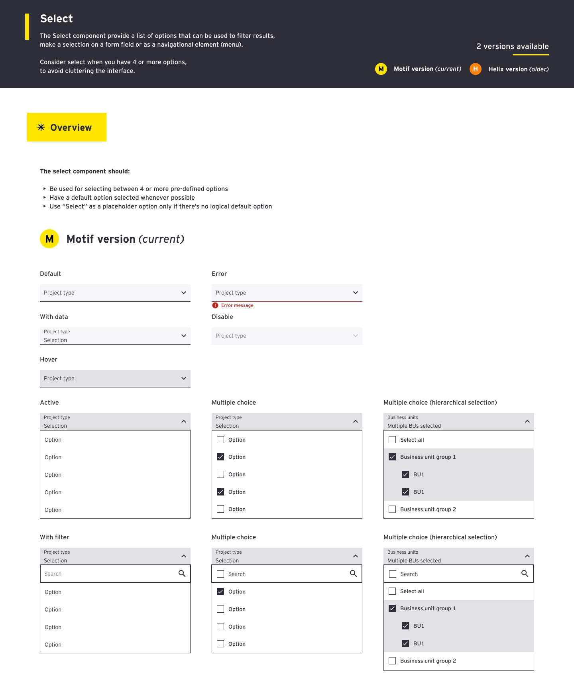
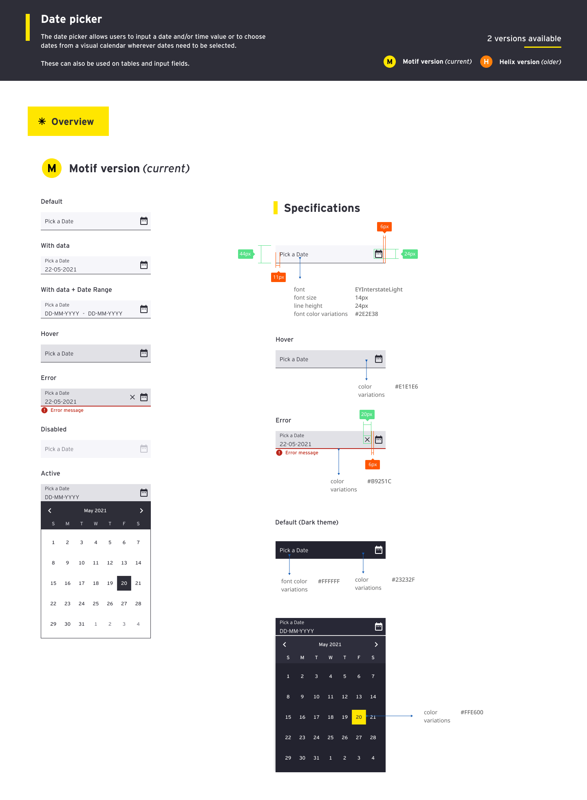
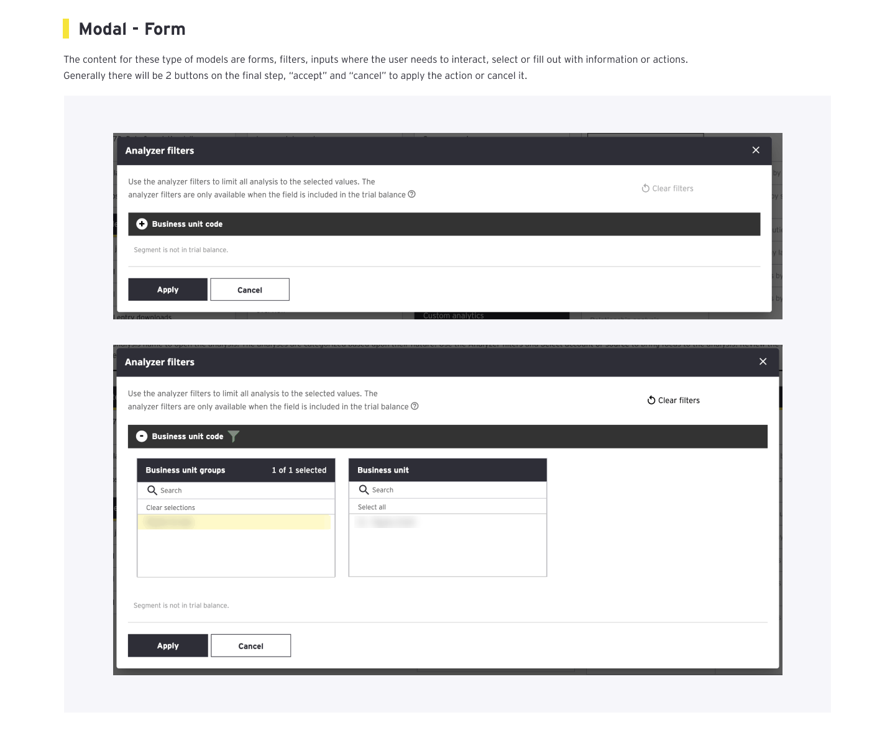

## Context

Helix is EY's global audit analytics platform: a library of analyzers that auditors worldwide run across a client's operating cycle. The work was to unify it onto a new design system.

## My role

Lead UX Designer through Cognizant Softvision, from November 2021 to July 2022, and Community Lead for the design team.

## Decisions

### Auditors' workflows before patterns

I interviewed auditors to ground the redesign, then iterated the data-presentation patterns against their real workflows.

### Written guidelines for Helix visualizations

I authored the Motif Guidelines for Helix Visualizations: color, typography and iconography standards. They didn't stay inside Helix; EY's other audit analytics tools adopted them too.

DIAGRAM: motif.svg "Auditor interviews shaped the data patterns; EY's audit tools adopted the Motif Guidelines"

### One architecture for a team of ten

I coordinated a team of ten designers alongside Product, Content and Business Development, and provided the guidance, architecture and patterns the other designers built from. As Community Lead I mentored them and tracked the team's health.

DIAGRAM: team.svg "I set the guidance, architecture and patterns the other designers built from"

## Outcome

Helix moved onto the new design system, and the Motif Guidelines I wrote for its visualizations were adopted across EY's audit analytics tools.

METRICS:
- **Motif Guidelines** adopted across EY's audit analytics tools
- **10** designers in the team I coordinated with Product, Content and BizDev
- Used by auditors worldwide

CTA: Designing a data-heavy platform many teams build on? [Let's talk](https://www.linkedin.com/in/myadarola/).
