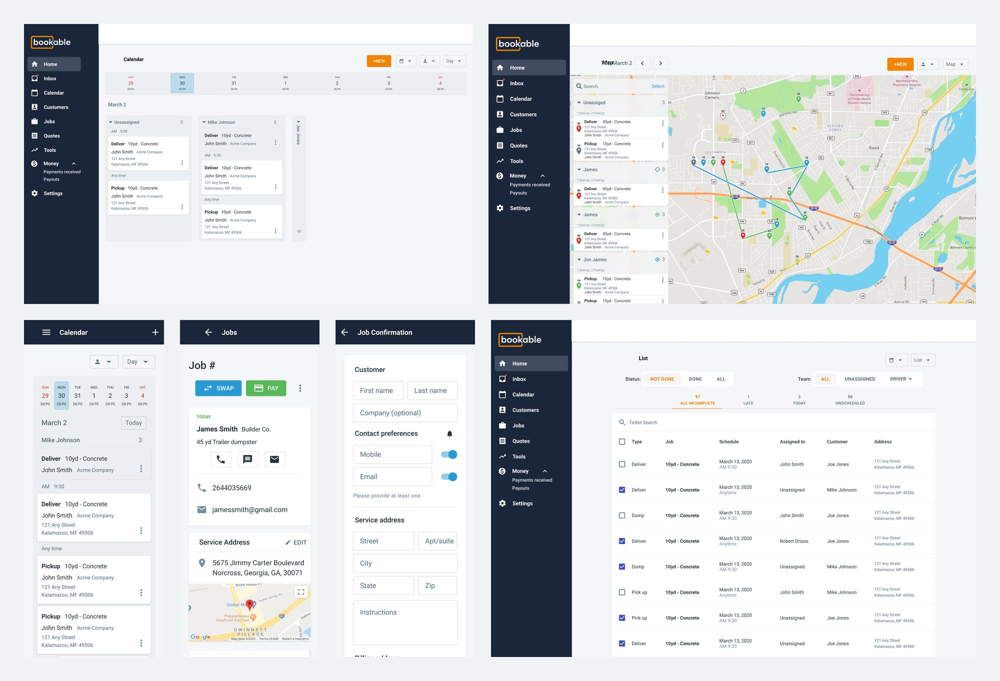
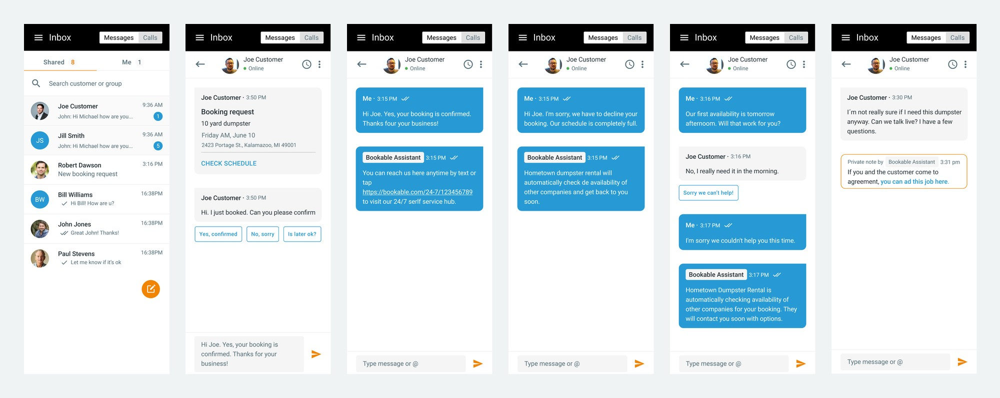
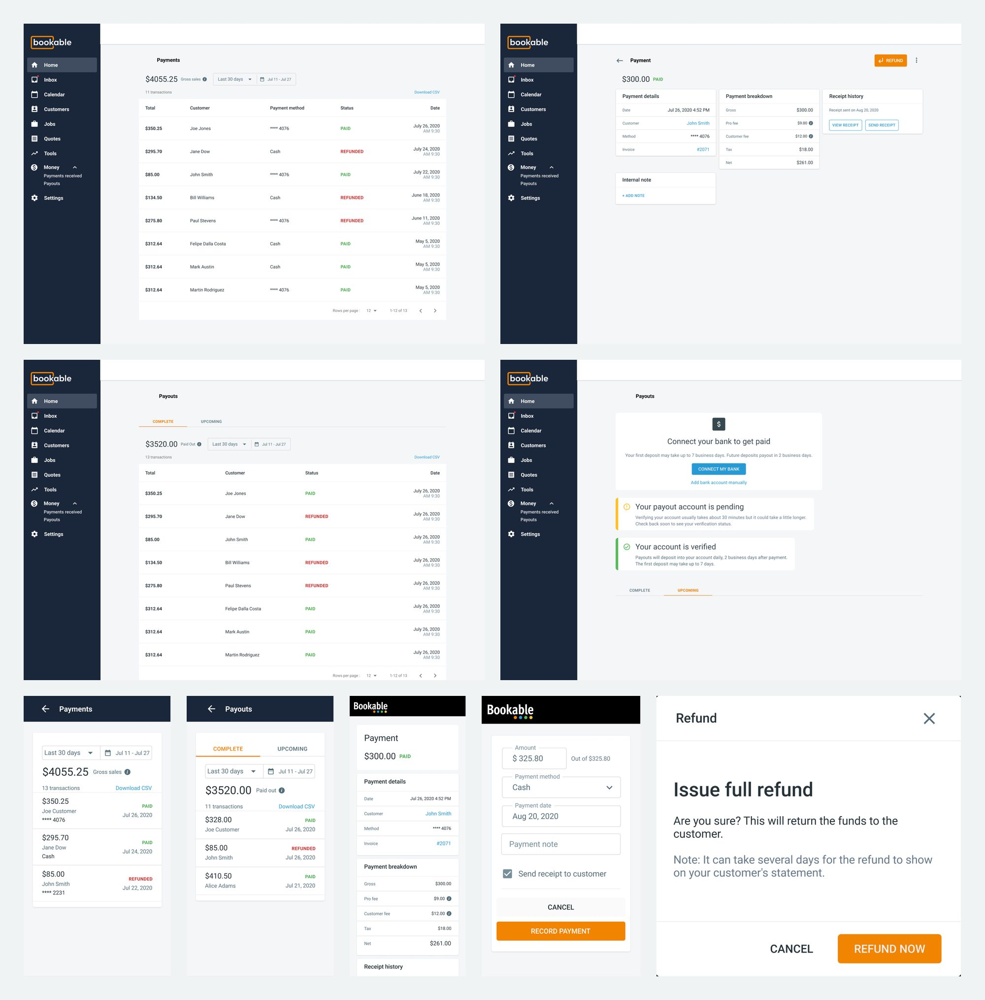

[Write-up (darwoft.com)](https://www.darwoft.com/blog/best-logistics-management-software-solution-service-providers)

## Context

I redesigned HometownLocal for the contractors and homeowners who were using it to find each other, then leaving the site to do everything else. The directory had traffic, but the connection stopped at the introduction. Scheduling, communication, and billing all happened somewhere else.

## My role

Senior UX designer at Darwoft, a boutique software shop in Argentina, in 2019. I researched pain points for providers and homeowners. Most complaints came down to the same thing: too many tools, none of them connected. We prototyped a unified flow and tested it with real providers. I worked with developers on scheduling logic and route optimization.

## Decisions

### The platform stays in the loop

A directory that puts up a link and walks away is a lost opportunity. We put ourselves in the middle and offered more: a platform that handles the job from booking through payment. The business model moved with it: subscription packages instead of a charge per response, with leads shared out by package.

Booking, scheduling, messaging, and invoicing all happen in one place. We gave providers a calendar, a Kanban board for job status, and route planning. We gave customers a single thread for each job. Every completed job triggers automatic billing.

### One price to compare

Every provider priced differently: dumpster sizes, state taxes, add-ons. Each one became a single price, so homeowners could compare providers side by side.

### Dispatch on one screen

Most providers had two or three people and ran the day in spreadsheets. Dispatch puts the map beside a board of drivers. Arrows mark delivery or pickup, pin colors show each job's status, and a job goes to a driver by dragging it. Select mode reassigns or reschedules many at once, and each driver's route draws on the map.

### One request, several quotes

A homeowner fills in one form. It reaches several providers by SMS, and each provider answers in a chat-style inbox.

## Outcome

METRICS:
- **5 tools** unified in one workspace
- **2M** annual visitors
- **12K** providers on the platform
- **Top** search result for dumpster rentals and junk removal

CTA: Building a marketplace or service platform? [Let's talk](https://www.linkedin.com/in/myadarola/).
