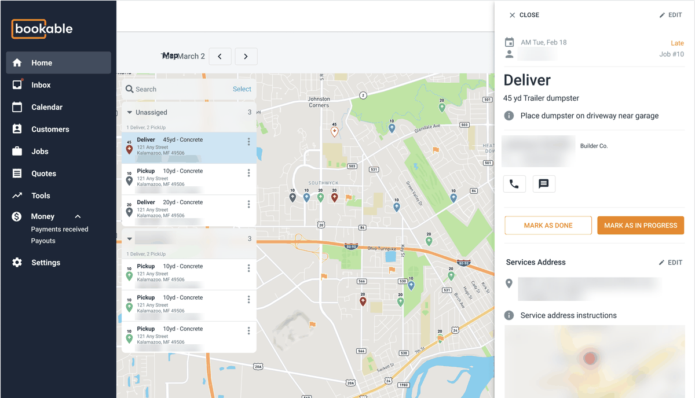
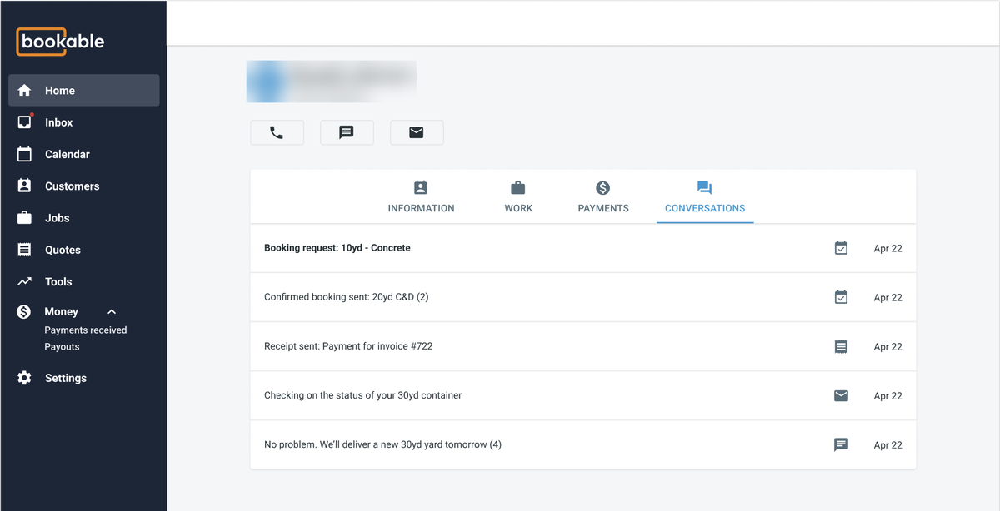
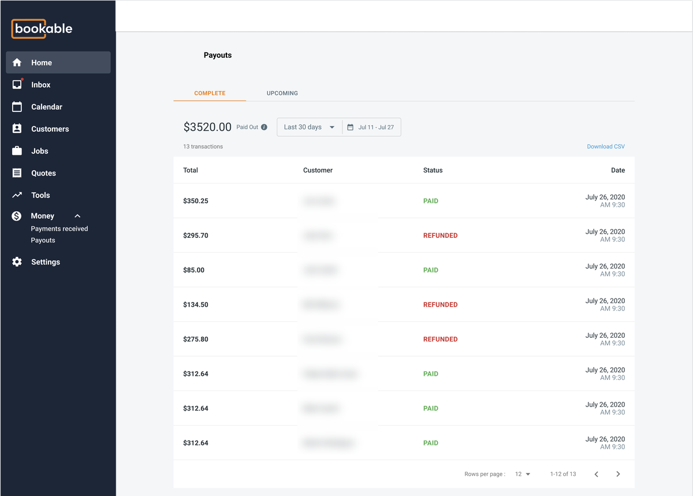

[Write-up (darwoft.com)](https://www.darwoft.com/blog/best-logistics-management-software-solution-service-providers)

## Context

I redesigned HometownLocal for the contractors and homeowners who were using it to find each other, then leaving the site to do everything else. The directory had traffic, but the connection stopped at the introduction. Scheduling, communication, and billing all happened somewhere else.

## My role

Senior UX designer at Darwoft, a boutique software shop in Argentina, in 2019. I researched pain points for providers and homeowners. Most complaints came down to the same thing: too many tools, none of them connected. We prototyped a unified flow and tested it with real providers. I worked with developers on scheduling logic and route optimization.

## Decisions

### The platform stays in the loop

The old directory was a dead end. Providers got leads but no tools.

We inserted ourselves into the middle. Instead of pointing users at providers and walking away, we built a platform that handled the transaction from booking through payment. The business model moved with it: an affiliate cut on the work instead of a fee per click.

DIAGRAM: before-after.svg "The directory handed off a lead; the platform keeps the whole job"

Booking, scheduling, messaging, and invoicing all happen in one place. We gave providers a calendar, a Kanban board for job status, and route planning. We gave customers a single thread for each job. Every completed job triggers automatic billing.

DIAGRAM: structure.svg "Homeowners get one thread, providers get the planning tools, and a finished job bills itself"

## Outcome

One workspace replaced five tools, and the platform earned an affiliate cut on the work instead of a fee per click.

METRICS:
- **5 tools** unified in one workspace
- **2M** annual visitors
- **12K** providers on the platform

CTA: Building a marketplace or service platform? [Let's talk](https://www.linkedin.com/in/myadarola/).
