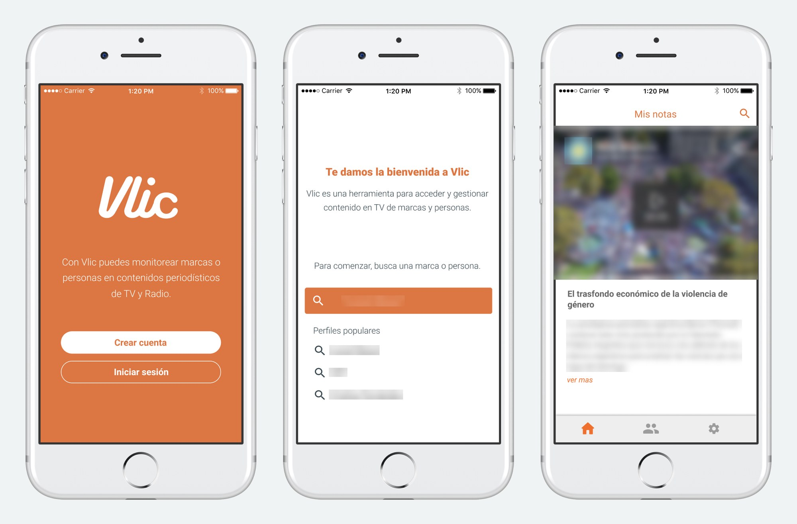
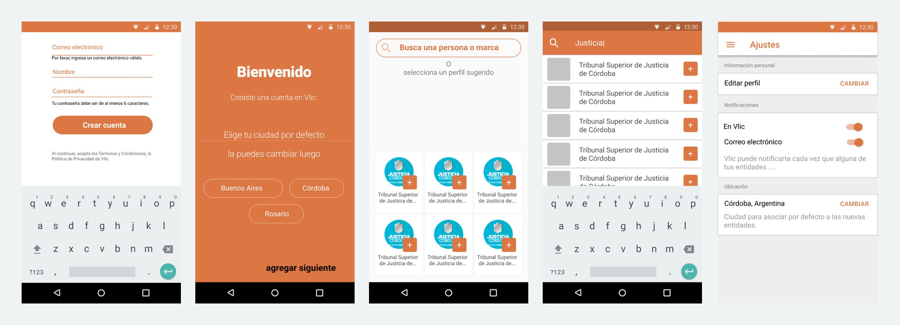

[View archive](https://web.archive.org/web/20180119002350/https://vlic.tv/)

## Context

Infoxel, now Seenka, is a media data platform for brands and agencies. It recorded TV and radio 24/7 for one purpose: verifying that ads aired. The infrastructure could capture, store, and search broadcast media at scale, and most of that capability sat unused beyond the ad-verification business.

The question I came in to answer was simple: what else could come out of it?

## My role

From November 2016 to July 2017 I was a Product Designer on new products. I explored ideas every week, prototyping and testing concepts that used the existing data with journalists, and I led the internal "hackathon" sessions that produced our new product suite.

## Decisions

### Vlic: real-time news monitoring

PR teams were learning about crises hours after they aired. Traditional monitoring was too slow.

We started with web dashboards, but they weren't immediate enough. User interviews pointed us toward mobile push notifications. The final app used ML-backed keyword alerts that pinged users the instant their term was mentioned on TV or radio, so they could react while the story was still developing.

You followed profiles, topics and cities, and Vlic pinged you when a new story mentioned one. Teams shared an inbox of stories nobody had edited yet, and each person kept a list of their own edits. It sold per user, with a free trial.

### Welo: live TV clipping

Newsrooms waited on engineers to pull footage. By the time they got clips, the window for social sharing had closed.

We built Welo.tv, a second-screen live DVR for Android, iOS and the web. Users dragged two handles over the live broadcast to mark a clip of 5 to 30 seconds, from up to an hour back, and published it. A clip went out to Facebook, Twitter or WhatsApp as a welo.tv link, or as a still image. Server-side processing kept the phone-side experience fast. Weekly sessions with journalists helped us cut export time to seconds.

## Outcome

METRICS:
- **5 to 30s** clips, cut from live TV
- **1 hour** of live broadcast to rewind
- **Vlic + Welo** new products
- **Real-time** vs day-after archive

Weekly prototyping sessions let us move from idea to validated concept in days. We dropped features that did not work and doubled down on the ones that did. The approach became the company's standard for trying new ideas.

The archive earned its keep another way too: I designed a swipe-based tool that crowdsourced labels for recorded video to train the ML models. I also headed Infoxel's rebrand: site, logo, brand book and media kit.

CTA: Need to modernize a legacy product or establish an innovation process? [Let's talk](https://www.linkedin.com/in/myadarola/).
