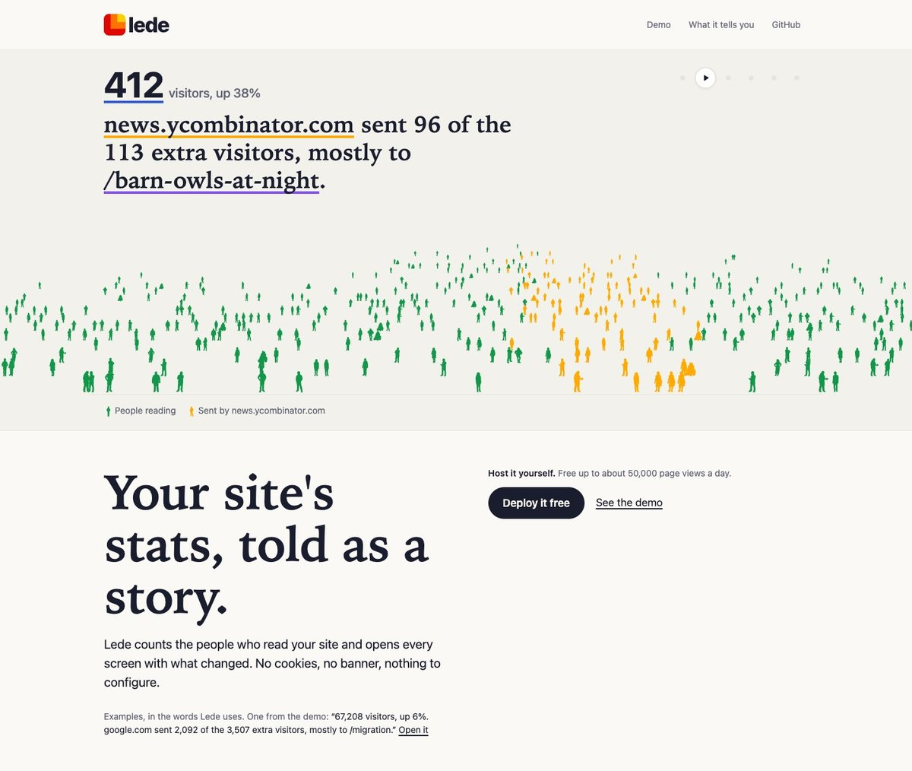
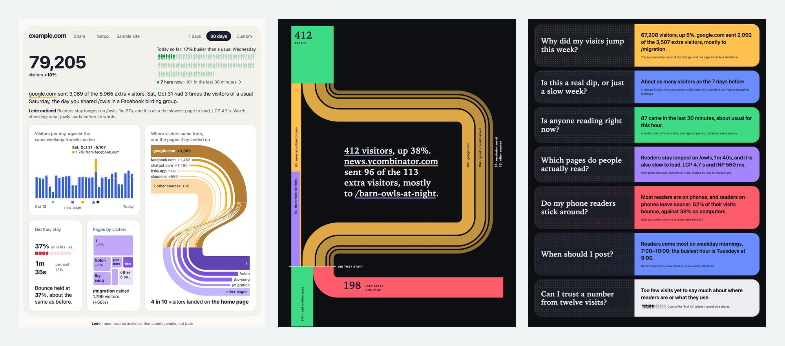
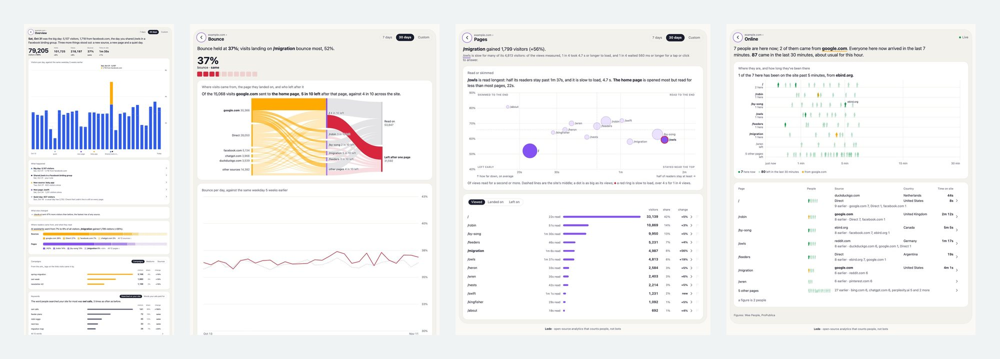
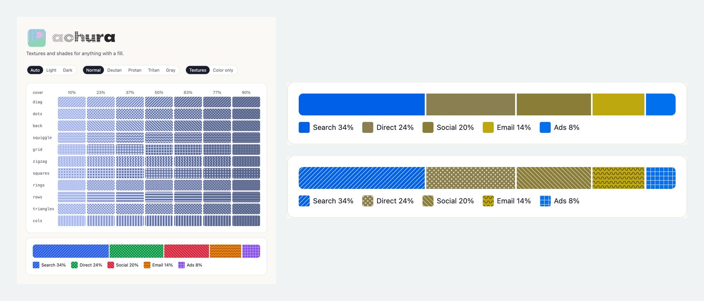

[Lede on GitHub](https://github.com/sryo/lede)

## Context

Most web stats tools are built to answer any question. They hand you a great deal of data and leave the reading to you. The question you open your stats with is simpler: did the small things I did (a post, a rewrite, a link someone shared) change who reads me? Lede answers it in sentences. The tools I had also counted mostly bots.

## My role

Lede is my own product. I design it and build it alone, since October 2026.

## Decisions

### People, not requests

Anything that isn't a person reading is left out, and when something can't be known Lede says so instead of guessing. A dip inside the usual swing is called what it is, and a handful of visits gets a count like "6 of 12" where a share would mislead.

### The sentence comes first

Lede says how many came, whether that is out of the ordinary, and where the change came from. Every screen opens with that sentence, and the numbers come after, to back it up.

### A texture as well as a color

A chart that tells its parts apart by color alone fails color-blind readers and fails in greyscale. I made [Achura](https://sryo.github.io/achura), a texture library, so every fill carries a texture as well as a color.

## Outcome

Lede is live and open source. A site adds one line to its pages, and the first sentence follows.

CTA: Have data that should read as a story? [Let's talk](https://www.linkedin.com/in/myadarola/).
