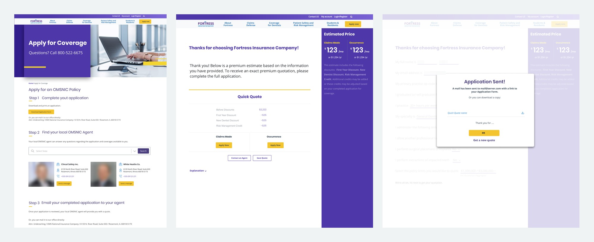
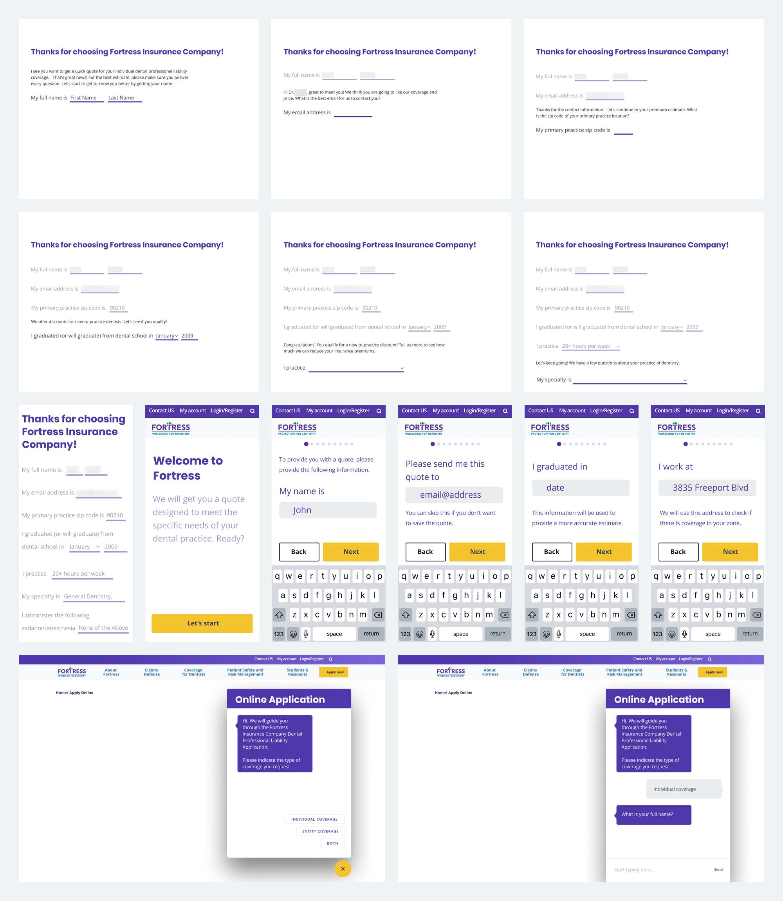
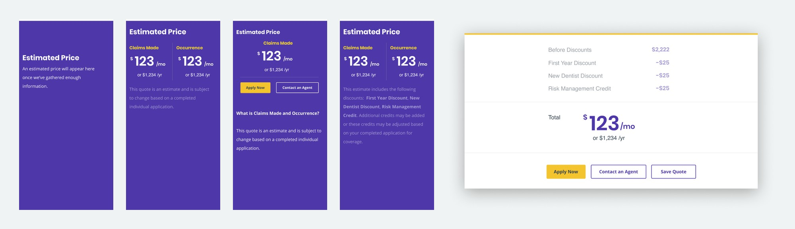
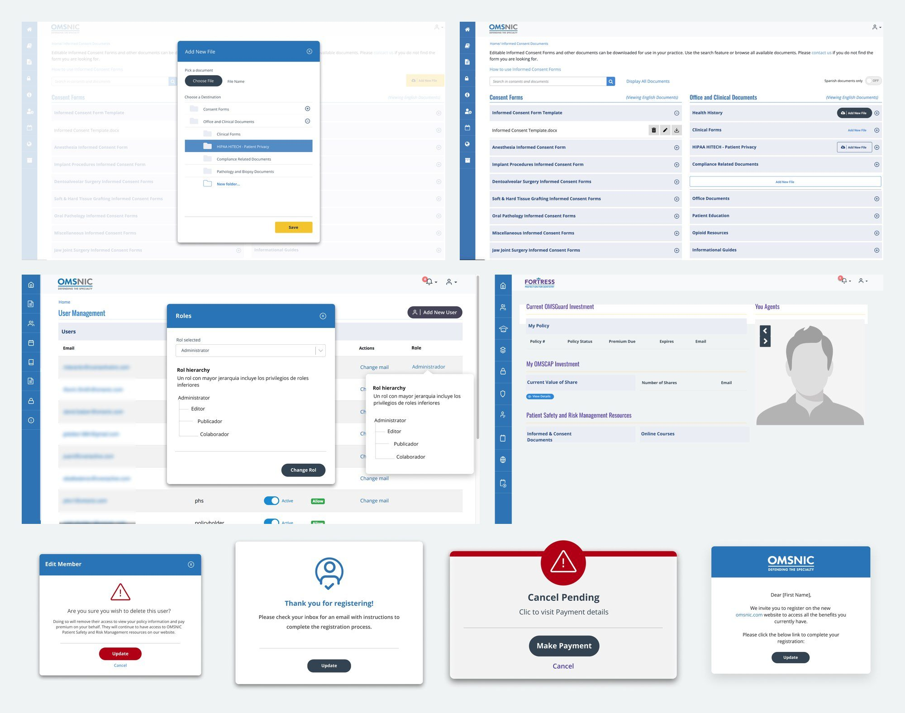

[quickquote.fortressins.com](https://quickquote.fortressins.com/)

## Context

I designed for dentists and oral surgeons buying liability insurance, people whose time is billed in surgical hours, not paperwork. Getting covered meant downloading the right form for your state, printing it and emailing it to a local agent, then waiting for a price.

OMSNIC needed more than a shorter application: a member portal and its Fortress liability CRM, on the public sites Omsnic.com and DDS4DDS.com. In the portal, coverage is billed as a subscription with automatic renewal, and every document keeps its version history.

## My role

Lead UI designer for a year, at Darwoft. I designed the portal, the CRM, the marketing site, the chatbot conversation flows and the design system built for the portal. I managed one .NET developer and wrote the Angular templates in HTML and Sass myself, alongside seven Angular developers.

## Decisions

### A quote, not a stack of PDFs

I replaced the state PDFs with Quick Quote: a dentist gets an estimate on the site, then applies from it.

### Questions as sentences

Each question is a sentence you finish: "My full name is ___ ___." The next one appears only after you answer. It talks back, too: "Hi Dr. Test, great to meet you!" Name, email, ZIP, graduation year, hours, specialty, sedation, procedures, limits. One at a time.

### The price moves while you answer

A live panel shows Claims-Made and Occurrence premiums side by side, and it updates with every answer. You see what each choice costs before you commit to it, not after an agent writes back.

### One portal for members and staff

Members see their policy, investments and risk resources in one place. Staff keep the consent forms and office documents current, with folders, uploads and roles. The modals, tables and emails come from the design system built for the portal.

## Outcome

METRICS:
- **9** questions to a live quote
- **0** PDFs to print

CTA: Simplifying complex forms or insurance workflows? [Let's talk](https://www.linkedin.com/in/myadarola/).
