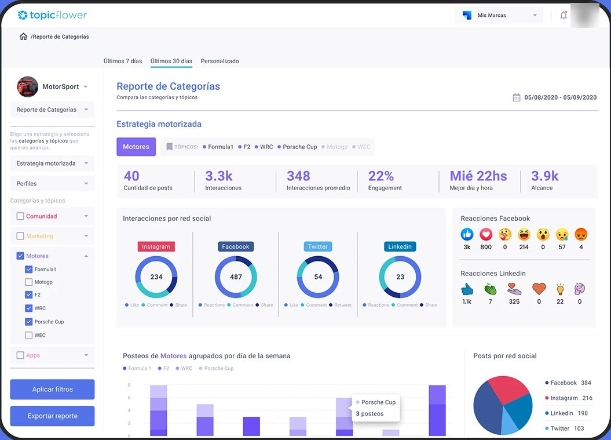
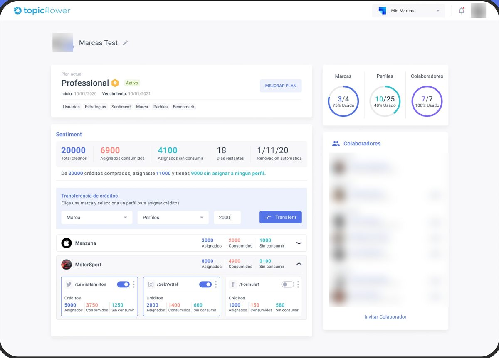
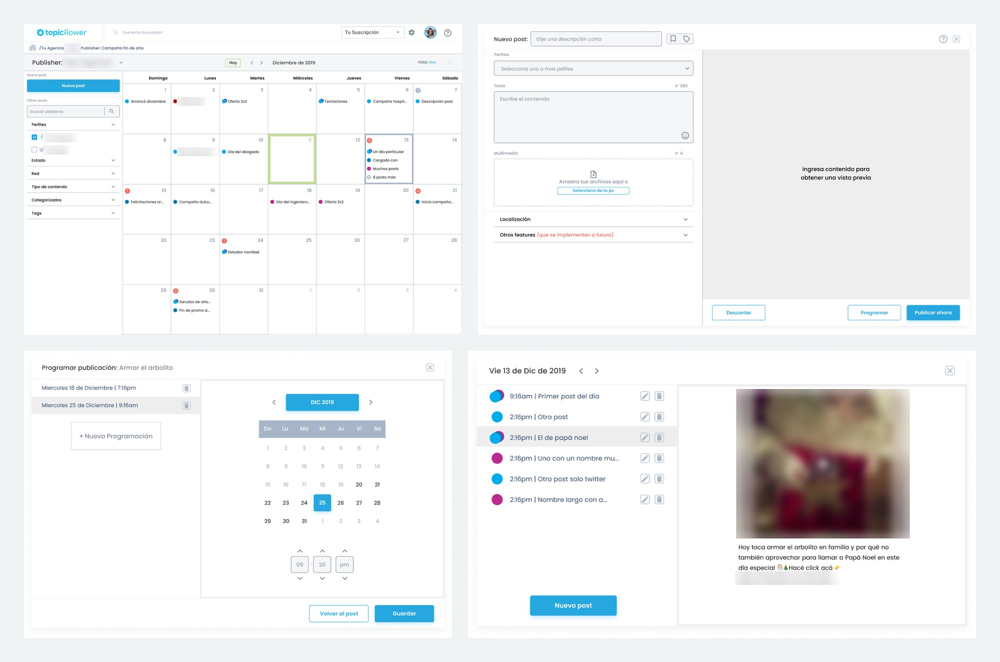

## Context

I redesigned TopicFlower for social media managers who had to prove ROI, not just show their clients a nice visualization. The original product displayed topics as a flower, each petal sized by engagement. Clients liked the visual.

As the market matured, brands wanted numbers they could act on. The flower was a conversation starter. Data-driven teams needed more.

Transform a visual novelty into an analytics platform without losing the identity that made TopicFlower distinctive.

## My role

Senior UX designer at Darwoft, the Argentine studio that rebuilt TopicFlower in 2019. I redesigned the app's usability and product strategy.

## Decisions

### Keep the flower, put the numbers underneath

Early TopicFlower was all form, little function. Users struggled to extract concrete numbers from the flower model.

We kept the flower as the hook and built a dashboard that prioritized metrics. It answered the "Who, What, When, Where" of engagement immediately. The flower became a supporting visual rather than the only interface.

### Pay in credits, share them out

Plans are bought as credits. The owner moves them between brands and profiles, and sees at a glance what's assigned, used and left. Owners, admins, coworkers and guests each get their own level of access.

### From a place you checked to a place you worked

We added a content calendar and scheduling tools, so managers planned in TopicFlower instead of only looking at it. We also built competitive benchmarking to compare performance against competitors, turning interaction data into strategic guidance.

### One design system for the new platform

Upgrading from a visual tool to a platform required a major overhaul. We used the Nebular Design System (Angular) to build a consistent interface. I worked closely with developers to make the new data visualizations performant and responsive.

## Outcome

Sales and client satisfaction went up with the new platform. Clients found it easier and faster to use.

METRICS:
- **Higher sales** and client satisfaction with the new platform
- **19** countries reached
- **IBM and Starbucks** among the enterprise clients it served

CTA: Turning data visualization into actionable insights? [Let's talk](https://www.linkedin.com/in/myadarola/).
