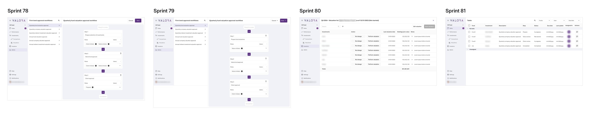
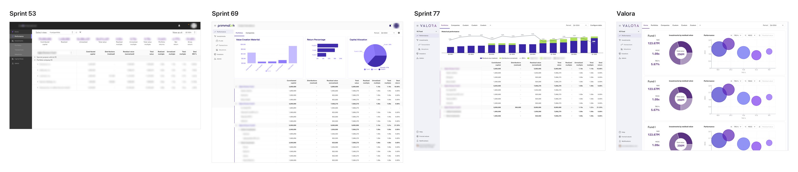
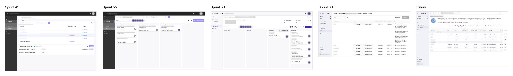

## Context

Valora Partners needed one platform for fund managers to value companies, manage their equity and follow the portfolio. Equity data came in as filings, and the platform had to read it without anyone retyping it.

## My role

I was the sole designer, through Santex, from June 2024 to December 2025: end to end across the Valuation, Equity and Portfolio modules, from the review flows and financial interfaces to the design system and who can access what.

## Decisions

### The AI suggests, the analyst commits

Equity data is read off filings by AI, so nobody retypes it. But a machine reading is a suggestion, not a fact. I designed a review step with approval gates: an analyst confirms or overrides every figure before it commits. Nothing reaches the data unreviewed.

DIAGRAM: review.svg "Every figure the AI reads off a filing waits for an analyst to confirm or override it"
TOY: review-gate

### Cap tables and scenarios you can work in

I built interactive cap tables and scenario modeling, and scenario-weighted ring charts with comparative time-series views.

### One design system for three modules

Valuation, Equity and Portfolio had to feel like one product. I authored a modular design system with tokens that spans all three. I also defined fund-user roles and access for institutional investors.

DIAGRAM: system.svg "One token set and design system under all three modules; fund-user roles decide access"

## Outcome

METRICS:
- **3** modules on one design system: Valuation, Equity, Portfolio
- Sole designer, end to end

CTA: Putting AI into a financial product people must trust? [Let's talk](https://www.linkedin.com/in/myadarola/).
