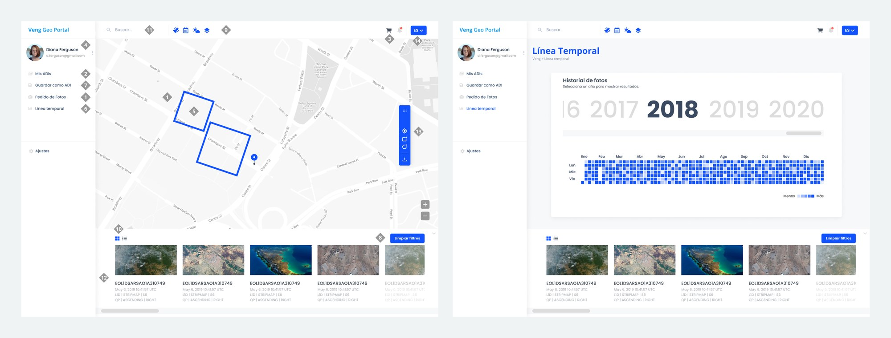
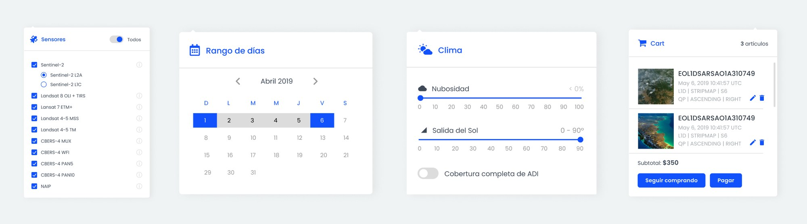

[Press coverage (La Voz)](https://www.lavoz.com.ar/negocios/con-una-pata-en-cordoba-una-empresa-creo-un-mercado-para-imagenes-de-satelites-argentinos)

## Context

Researchers, agronomists and analysts needed SAOCOM satellite imagery but had to go through agencies and paperwork to get it. SAOCOM is an Argentine constellation that captures Earth imagery around the clock in any weather, and most of the people who could use it never saw it.

We built a self-serve e-commerce platform to change that. Users search a map by location, date, and cloud cover, preview a low-resolution image, and buy. For areas the catalog didn't cover, they submit a tasking request for new captures.

## My role

I led UX through Darwoft in 2019.

## Decisions

### Familiar e-commerce patterns for unfamiliar SAR imagery

SAR imagery is unfamiliar to most users, so the design leaned on familiar e-commerce patterns: search, preview, add to cart, checkout. An empty search wasn't a dead end: it led to the tasking request.

## Outcome

SAOCOM imagery went on to sell 2,600+ images and bill over US$2M.

METRICS:
- **2,600+** images sold
- **$2M+** billed, in US dollars
- **7** distributors (e-GEOS, Telespazio, URSA, Suhora, MDA, BSED, Restec)
- **24h** catalog order delivery
- **Catalog + tasking** dual capture flow

CTA: Working on geospatial products or complex data platforms? [Let's talk](https://www.linkedin.com/in/myadarola/).
